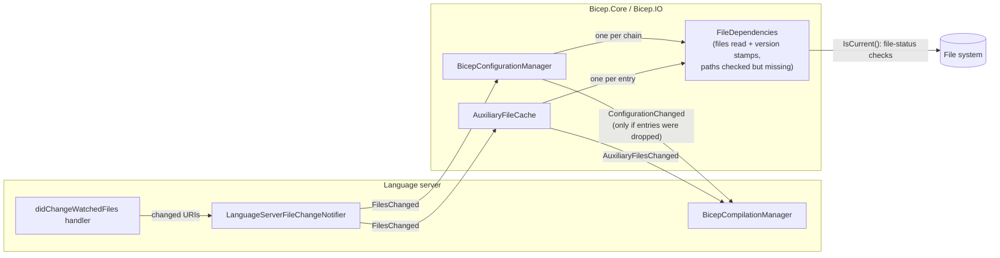
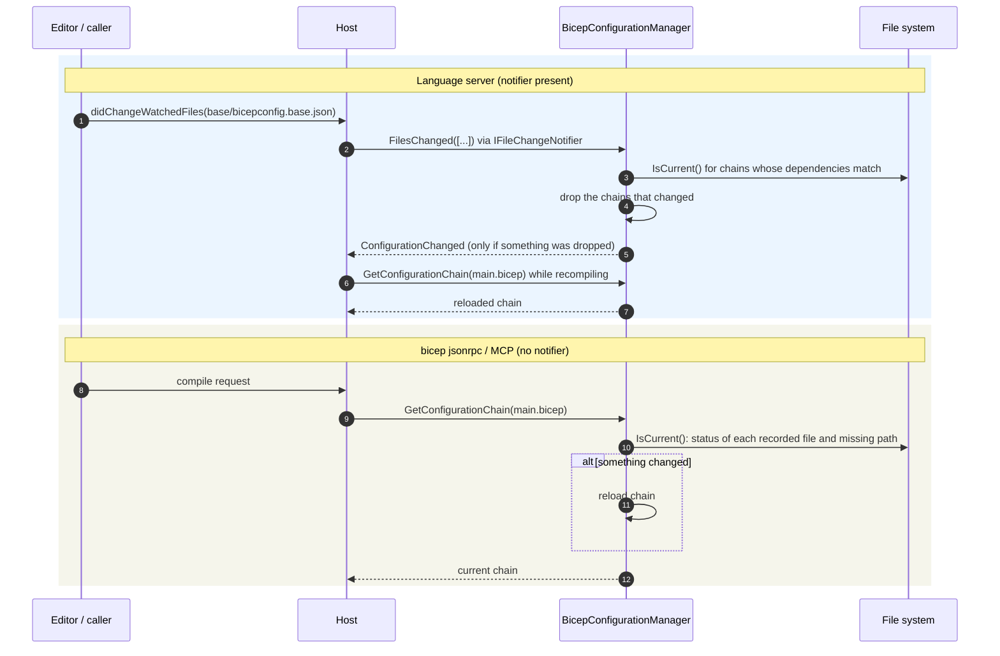

# Bicep configuration: implementation plan

Scope: everything under `src/Bicep.Core/Configuration`, plus the code that loads, caches and reads `bicepconfig.json`: the language server's config lifecycle, `BicepSourceFile.LoadConfiguration`, `FeatureProvider`, linter rules, and artifact and extension resolution.

The work is 13 PRs, plus one in a later release:

- **Fixes (PR 1)**: crashes and cache invalidation. In review (#20561).
- **Loading (PRs 2–4)**: a loader pipeline that records which file set each value, so errors and relative paths use that file; the cache root moves to an environment variable.
- **Cache freshness (PRs 13–14)**: caches record the files they read and check them themselves, so every host (language server, `bicep jsonrpc`, MCP server) sees file changes; the language server pushes file events through a shared notifier.
- **Models and validation (PRs 5–9)**: plain records, typed sections, warnings for unknown and ignored settings, per-section fallback.
- **Access (PRs 10–11)**: one configuration snapshot per compilation; the explicit config path passed in instead of ambient state.

PRs that change user-visible behavior are marked **(behavior change)**. Everything else keeps behavior.

---

## 1. Status

| PR | Summary | Files (product + test) | After | Status |
|---|---|---|---|---|
| 1 | Config errors become diagnostics; correct cache invalidation | ~9 + ~11 | – | In review (#20561) |
| 2 | Loader pipeline: parse cache, one merge that records the declaring file, per-file diagnostics | ~13 + ~7 | 1 | Planned |
| 3 | The declaring file is used everywhere: `bicep.version`, aliases, mocks, relative paths | ~12 + ~8 | 2 | Planned |
| 4 | `BICEP_ARTIFACT_CACHE_DIR`; `cacheRootDirectory` deprecated | ~5 + ~5 | 2 | Planned |
| 5 | Sections and `BicepConfiguration` become records; one source of defaults | ~18 + ~6 | 3 | Planned |
| 6 | Typed analyzer settings, with warnings for unknown rules and ignored values | ~9 + ~10 | 5 | Planned |
| 7 | Experimental features as a set; warnings for unknown settings and `null` | ~12 + ~8 | 5 | Planned |
| 8 | Typed extension sources and cloud profiles | ~13 + ~7 | 5 | Planned |
| 9 | Per-section fallback | ~5 + ~3 | 5 | Planned |
| 10 | One configuration snapshot per compilation | ~13 + ~14 | 2 | Planned |
| 11 | Explicit config path passed in; `ExplicitConfigurationContext` removed | ~6 + ~2 | 2 | Planned |
| 12 | *(later release)* Remove the `cacheRootDirectory` property | ~3 + ~3 | 4 | Later |
| 13 | Configuration cache checks its own dependencies; shared file-change notifier | ~10 + ~6 | 2 | Planned |
| 14 | Auxiliary file cache (`load*()` files) uses the same mechanism | ~5 + ~4 | 13 | Planned |

File counts are estimates from today's call sites. PRs 5 and 10 are larger, but most of their edits are the same change repeated (noted in each PR). PRs 13 and 14 were added after PR 1 showed that the CLI JSON-RPC and MCP servers never see file changes (B6).

```
1 -> 2 ─┬─> 3 -> 5 ─┬─> 6
        │           ├─> 7
        │           ├─> 8
        │           └─> 9
        ├─> 4 ··· (one release later) ··· 12
        ├─> 10
        ├─> 11
        └─> 13 -> 14
```

After PR 2, four tracks can run side by side: PRs 3, 5 and 6–9 in order, PR 4, PRs 10–11, and PRs 13–14. PRs 6, 7, 8 and 9 only depend on PR 5.

---

## 2. Problems

Each item was confirmed with the Debug CLI built from `main`, or by reading the code where noted.

### 2.1 Bugs

| # | Problem | Evidence | Fixed in |
|---|---|---|---|
| B1 | Invalid values crash the compiler instead of producing a diagnostic (regression) | `{"experimentalFeaturesWarning": "yes"}`, `{"bicep": "1.0"}` and `{"extends": 5}` each make `bicep build` exit with an unhandled exception. `BuildChain` only catches `ConfigurationException`; before `d6d06cb66`, `ConfigurationManager` also caught `JsonException` and `Exception`. | PR 1 |
| B2 | Relative paths in an inherited config are resolved against the leaf (the nearest `bicepconfig.json`) | A base config with `"extensions": {"foo": "./ext/foo.tgz"}` resolves the path from `child\ext\foo.tgz`. The same is true for documentation paths (`DocsGenerationOptionsResolver`). Only `moduleAliasesMock` uses the file that declared the value. | PR 3 |
| B3 | Errors are blamed on the wrong file | An invalid `currentProfile` in a base config reports BCP273 against the child's `bicepconfig.json`. Module alias errors (`ModuleAliasesConfiguration.configFileUri`) also always name the leaf. | PRs 2, 3 |
| B4 | Per-file config diagnostics are always empty (code reading) | `BicepConfiguration.Bind` passes `diagnostics: null`, so every layer has none. `EnumerateDiagnosticsPerFile` only ever returns empty arrays. The doc comments on `IBicepConfiguration.GetDiagnostics` and `BicepConfigurationChain.GetEffectiveConfiguration` describe aggregation that doesn't happen. | PR 2 |
| B5 | A failed chain stays cached after the file is fixed (code reading) | `LoadChain` records a chain's files only when loading succeeds. After a parse error or a missing base file, `PurgeCacheForAffectedChains(base)` finds nothing to purge. In the language server this is hidden because the change event purges everything. | PR 1 |
| B6 | Long-running hosts other than the language server never see file changes (code reading) | `bicep jsonrpc` and the MCP server use the same singleton `BicepConfigurationManager` and `AuxiliaryFileCache`, and nothing in `Bicep.Cli` or `Bicep.McpServer*` ever invalidates or trims them. An edited `bicepconfig.json`, or a file read by a `load*()` function, isn't picked up until the process restarts, and `AuxiliaryFileCache` grows without limit. | PRs 13, 14 |
| B7 | Config changes the language server missed | The watched-files handler only reacted to files named exactly `bicepconfig.json`, so editing an extended base config such as `bicepconfig.base.json` never refreshed anything. Clients may also report only the folder when a folder is deleted, which exact URI matching misses. | PR 1 |

### 2.2 Silent misconfiguration

| Input | Result | Fixed in |
|---|---|---|
| `"experimentalFeaturesEnabled": {"symbolicNameCodeGen": true}` (wrong casing) | Ignored | PR 7 |
| A misspelled top-level key such as `"analyzerz"` | Ignored | PR 7 |
| A rule with `"level": "eror"` | The rule's default level is used | PR 6 |
| A rule with `"maxAllowedAgeInDays": "abc"` | The default of 730 is used | PR 6 |
| A child with `"bicep": {"version": null}` | Silently ignored; the base's version still applies | PR 7 |

### 2.3 Design debt

- **Loader**
  - `LoadChain` and `BuildChain` read files, follow `extends`, merge, bind, check trust and record where each value came from, all at once.
  - Each step reports errors differently: some return diagnostics, some throw, some swallow the error.
  - A shared base config is re-parsed for every leaf that extends it.
  - `JsonElement.Merge` re-serializes the whole document for every layer.
  - Every layer is also merged with the built-in config and bound again, and the result is thrown away (B4).
- **"Which file set this?"** is handled three different ways: a per-alias `DeclaringConfigUri` for mocks, `CompilerConfiguration.WithDeclaringUri`, and the leaf URI for everything else.
- **Caches**
  - `PurgeCacheForAffectedChains` clears the entire file lookup cache.
  - `PurgeChainCache`, `PurgeCache` and `PurgeLookupCache` aren't used in product code.
  - `directoryHandleCache` grows without limit and caches a trivial `GetParent()`.
  - `HandleBicepConfigChangeEvent` purges everything and then does a targeted purge.
- **Models**
  - `ConfigurationSection<T>` plus nine `IBicep*Configuration` interfaces that each have exactly one implementation. Code keeps casting them back to the concrete classes: `ToUtf8Json`, `ModuleReferenceCompletionProvider`, `BuildChain` and the test helpers.
  - `BicepConfiguration` has a 14-parameter constructor plus a `With(...)` with 14 nullable parameters, so a value can't be set to `null`.
  - Only `Cloud` uses source-generated JSON; the other sections use reflection with trimming warnings (IL2026) suppressed.
  - `AnalyzersConfiguration` keeps the raw `JsonElement` and is looked up by path string on every call.
  - `ExperimentalFeaturesEnabled` is a record with 16 positional booleans, so adding a feature means editing four places.
  - `ExtensionConfigEntry` is a plain string checked against `"builtin:"`.
- **Defaults** are kept in four places: the built-in `bicepconfig.json`, C# property initializers (documentation example sources are written out in both), fallbacks hand-written in `Bind`, and the VS Code schema.
- **How code gets configuration**
  - `BicepSourceFile.LoadConfiguration()` goes through the manager on every call (about 10 call sites). In the language server, a purge in the middle of a compile can give one compilation two different configs.
  - `ExplicitConfigurationContext` is ambient `AsyncLocal` state.
- **Error messages**: BCP273 says "Failed to parse the contents" even when the JSON parsed but a value is invalid. The language server publishes every config diagnostic at `Range(0,0,0,0)`.

---

## 3. Target architecture

### 3.1 Loader pipeline

```
source file URI
  -> (1) Locate      explicit --config file, or nearest bicepconfig.json     -> leaf IOUri | none
  -> (2) Read        per file, cached by URI                                -> ConfigurationFile
  -> (3) Chain       follow "extends" (relative only, no cycles, depth <= 64) -> ImmutableArray<ConfigurationFile>
  -> (4) Merge       built-in + layers, recording where each value came from  -> MergedConfiguration
  -> (5) Bind        typed records, values checked, paths made absolute      -> BicepConfiguration + diagnostics
  -> (6) Policy      cloud trust and per-section fallback                    -> BicepConfigurationChain
```

Rules:

- **Every step returns `(value, diagnostics)`. No step throws for user input.** An exception that reaches the manager is a Bicep bug. The manager reports it as a BCP272 diagnostic as a last resort, and a unit test enforces that no known kind of bad input gets that far.
- **A diagnostic names the file, and the property, that caused it.** Each config diagnostic carries the declaring file URI and a JSON path.
- **Steps don't share mutable state.** The manager only coordinates them and owns the caches.

Types:

| Type | Role |
|---|---|
| `ConfigurationFile` | `Uri`, the parsed `JsonElement` root, the raw `extends` value, and read or parse diagnostics. Immutable. |
| `ConfigurationFileReader` | Reads and parses one file (comments and trailing commas allowed, as today). Never throws. |
| `ConfigurationChainResolver` | Follows `extends` from a leaf `ConfigurationFile`. Owns the cycle, depth, absolute-path and type checks. Reports a cycle in chain order. |
| `ConfigurationMerger` | Deep-merges the built-in config and the layers in one pass over `JsonNode`, producing `MergedConfiguration(JsonElement Root, ConfigurationProvenance Provenance)`. |
| `ConfigurationProvenance` | Maps a JSON path to the URI of the file that declared it (`null` means built-in). Lookup uses the longest matching path prefix. Replaces the three existing mechanisms. |
| `ConfigurationBinder` | `MergedConfiguration` -> `BicepConfiguration` plus diagnostics. Each section has a binder; each binder gets the provenance so it can resolve paths and report against the right file. |
| `ConfigurationDiagnostic` | Internal: `(IOUri? File, string JsonPath, DiagnosticLevel Level, string Code, string Message)`. Converted to `IDiagnostic` at the edge. |

### 3.2 Caches and freshness

| Cache | Key | Value |
|---|---|---|
| Located leaf | directory | leaf `IOUri?` |
| Parsed file | file `IOUri` | `ConfigurationFile` |
| Chain | leaf `IOUri` | `BicepConfigurationChain` and its `FileDependencies` |

**After PR 1 (interim).** The configuration manager records which files each chain read, including failed chains (fixes B5). The language server forwards every watched-file event to `InvalidateFile(uri)`, which drops each chain that read the file or anything under it (a folder event covers its contents). An event on any `bicepconfig.json` also resets discovery, because clients don't reliably say whether a file was created or changed. This works for the language server only; other hosts never call it (B6).

**Target (PRs 13–14).** Each cache owns its freshness. Callers don't tell it what to invalidate.

1. **Recorded dependencies.** A shared `FileDependencies` type in `Bicep.IO` records, for one cache entry, every file it read with a version stamp (last-write time and size), and every path it checked that didn't exist. For configuration, that's each file in the chain plus every directory searched for a `bicepconfig.json` without finding one. That second list is what catches a config file created closer to the source file.
2. **Version checks.** `FileDependencies.IsCurrent()` compares the recorded stamps with the file system: a file changed or was deleted, or a missing path now exists. `IFileHandle` gets a version API for this; the in-memory file system returns a counter that increases on every write.
3. **An optional notifier.** `IFileChangeNotifier` in `Bicep.IO.Abstraction` publishes batches of changed URIs. Only the language server provides one, fed by `didChangeWatchedFiles`. Caches subscribe, find entries whose dependencies match (a folder covers everything under it), check those entries' version stamps right away, and drop the ones that changed. The configuration manager raises `ConfigurationChanged` only if it dropped something, and the compilation manager refreshes compilations from that event, not from raw file events. That way it never recompiles before the configuration cache has been updated, or for events that didn't change anything (some watchers report a folder as "changed" when files inside it change).
4. **Re-checking depends on the host.** With a notifier, entries are checked only when an event matches them, so steady-state requests cost nothing. Without one (CLI commands, `bicep jsonrpc`, MCP server), entries are checked against their version stamps when they're read: a few file-status calls, once per request.

With this, `InvalidateFile` and the invalidation part of `BicepConfigLifecycleManager` go away; the lifecycle manager only publishes diagnostics for open config files. `InvalidateAll()` stays as an explicit command.



How each host sees an edit to a base config:



**Why not a file watcher for `bicep jsonrpc` and the MCP server?** The interface allows one later, but it isn't needed now:

- These servers have no workspace root. Each request brings arbitrary paths, so a watcher implementation would have to start and stop directory watchers for every file read, count references, and dispose of them when cache entries are dropped.
- `FileSystemWatcher` is least reliable in the places that matter:
  - Editors often save by writing a temp file and renaming it, so a save shows up as a rename.
  - Its buffer can overflow and drop events; the only signal is its `Error` event, which then has to clear everything.
  - Linux limits how many watches a user can have.
  - Network shares, WSL and container mounts are unreliable.
- These servers compile once per request, so checking a few file versions per request costs microseconds and is deterministic.

### 3.3 Merge rules

- Objects merge deeply, property by property; the more specific (child) file wins.
- Arrays and plain values are replaced wholesale.
- **`null` is not allowed anywhere.** A `null` value gives an "ignored setting" warning (3.4) that names the file and property, and the value is ignored, so the inherited value stays. This is what already happens today, minus the warning, and it matches the schema, which allows `null` nowhere. A child changes an inherited value by setting a different one; nothing can be cleared or removed.
- `extends` is removed before merging, and `$schema` is ignored.
- These rules go into `docs/` and into the doc comment on `ConfigurationMerger`, and are covered by tests.

### 3.4 Diagnostics

One code per category, with the message saying what's wrong and where:

| Category | Level | Code | Covers | Result |
|---|---|---|---|---|
| Invalid configuration | Error | BCP273 (reworded) | A value that prevents a section from binding: wrong type for a section, invalid cloud profile, invalid `bicep.version` range, invalid docs path | The section falls back to the built-in default (PR 9) |
| Unknown setting | Warning | new | An unknown top-level property, experimental feature name, analyzer namespace or rule name | Ignored |
| Ignored setting | Warning | new | `null`, an invalid rule `level`, a rule option of the wrong JSON type | Ignored; the inherited or default value stays |
| Deprecated setting | Warning | new | `cacheRootDirectory`, and experimental features that have graduated or been removed | Still honored until removed (a removed feature does nothing) |
| Chain errors | Error | BCP271, BCP272, BCP453–BCP455 (existing) | Unreadable or unparsable file, absolute `extends`, cycle, depth; plus a non-string `extends` (new message under BCP453) | The whole built-in config is used |

BCP273's new wording applies to values as well as JSON parsing: `"The Bicep configuration file "{uri}" is invalid: {message}."`

Every message includes the JSON path (for example `analyzers.core.rules.no-unused-params.level`) so the setting is easy to find. Warnings can fail CI pipelines that treat warnings as errors, so the release notes list the new warnings.

### 3.5 Models

```csharp
public sealed record BicepConfiguration(
    CloudConfiguration Cloud,
    ModuleAliasesConfiguration ModuleAliases,
    ModuleAliasesMockConfiguration ModuleAliasesMock,
    ExtensionsConfiguration Extensions,
    ImmutableArray<string> ImplicitExtensions,
    AnalyzersConfiguration Analyzers,
    FormattingConfiguration Formatting,
    DocumentationConfiguration Documentation,
    CompilerConfiguration Compiler,
    ExperimentalFeatures ExperimentalFeatures,
    string? CacheRootDirectory,          // deprecated (PR 4), removed in PR 12
    bool ExperimentalFeaturesWarning,
    IOUri? ConfigFileUri,
    ImmutableArray<IDiagnostic> Diagnostics);
```

- Every section is a `sealed record` that holds data plus the methods that belong with it (alias lookups, `TryGetExtensionSource`). `ConfigurationSection<T>` and `IWritableConfigurationSection` are deleted. Tests change settings with `with`.
- Sections keep their current class names, so callers that already use a concrete class don't change.
- Interfaces: the section interfaces with few users are deleted. `IBicepCloudConfiguration` (51 files) and `IBicepConfiguration` (58 files) stay. `CloudConfiguration` and `BicepConfiguration` implement them, and the record properties use the concrete types, so the casts go away without touching every caller. Removing those two interfaces would be a separate rename-only PR, only worth doing if they cause confusion.
- `FormattingConfiguration` keeps exposing `PrettyPrinterV2Options`: about 19 files read it, and a separate config-owned type would only add a mapping layer.
- Paths are resolved when binding, so a record holds absolute `IOUri`s, never strings relative to some config file.
- Serialization to JSON (`ToUtf8Json`, which only tests use: `BicepConfigurationAssertions`, `BicepConfigSchemaTests`) goes through a source-generated `BicepConfigurationJsonContext`.
- Typed sections:
  - `AnalyzersConfiguration`: `Enabled`, `Verbose`, and `ImmutableDictionary<string, RuleConfiguration>`, where `RuleConfiguration(DiagnosticLevel? Level, JsonElement Options)` (PR 6).
  - `ExperimentalFeatures`: a set of enabled feature names, checked against `FeatureProvider` metadata, with typed properties for the features in use (PR 7).
  - `ExtensionsConfiguration`: `ImmutableDictionary<string, ExtensionSource>`, where `ExtensionSource` is `BuiltIn`, `LocalFile(IOUri)` or `Reference(string)` (`br:`, `ts:`, ...) (PR 8).
  - `CloudConfiguration`: profiles parsed to `Uri`, equality over every field (PR 8).

### 3.6 How code gets configuration

- `SourceFileGroupingBuilder` already calls `LoadConfiguration()` for each file it adds. It takes **one** `BicepConfiguration` (and `IFeatureProvider`) per source file and stores it on the grouping, and every consumer in that compilation reads from there.
- This can't be stored on `BicepSourceFile`: the language server reuses source file instances across config changes (`RefreshAllActiveCompilations` and the copy constructor keep the same file), so a snapshot there would go stale.
- `ExplicitConfigurationContext` is replaced by an explicit config path passed in. The CLI and JSON-RPC create a manager scoped to the explicit file for that operation, instead of using `AsyncLocal`.

---

## 4. PRs

Verify with `dotnet test --solution Bicep.slnx --no-build` (full suite). To update baselines, run `-- --filter "TestCategory=Baseline" --test-parameter SetBaseLine=true`, then run the tests again, and review every baseline diff.

### PR 1 – Config errors become diagnostics; correct cache invalidation **(behavior change: crashes become errors)**

Fixes B1, B5 and B7. Two independent fixes in the same files (`BicepConfigurationManager` and its tests), so they're reviewed together.

Errors:

1. `BuildChain`: wrap binding of the merged config in `catch (ConfigurationException)`, `catch (JsonException)` and `catch (InvalidOperationException)`, all mapped to BCP273. Add a last-resort `catch (Exception)` mapped to BCP272, matching the handling before `d6d06cb66`.
2. `LoadChain`: check that `extends` is a string. Any other non-null value reports an error: `"The "extends" value in the Bicep configuration file "{uri}" must be a string."`
3. `FindCompilerVersionDeclaringUri`: check that `bicep` is an object before reading from it.
4. Remove the per-layer binding in `BuildChain`: it never produces diagnostics (B4) and it swallows exceptions. Keep layer entries that only carry each file's URI, so the language server keeps clearing old squiggles until PR 2.
5. Build the cycle message from the ordered list of layers, not by enumerating the `HashSet`.
6. Reword BCP273 (3.4). Fix the doc comments on `IBicepConfiguration.GetDiagnostics` and `BicepConfigurationChain.GetEffectiveConfiguration`.

Caching:

7. Record the chain's files as soon as each file is read, before any early return, so failed chains are tracked too.
8. `PurgeCacheForAffectedChains` stops clearing the lookup cache on every match; only events on a `bicepconfig.json` reset discovery.
9. Remove `directoryHandleCache`: building a directory handle is in-memory string work, and handles compare by URI, so the lookup cache still hits.
10. Replace `PurgeCacheForAffectedChains`, `PurgeAllCaches` and `PurgeChainCache` with `InvalidateFile(uri)` (returns whether anything was dropped) and `InvalidateAll()`. Delete `PurgeCache`, `PurgeLookupCache`, `GetDependenciesForLeaf` and the unused `BicepConfigurationChain.GetAllDiagnostics`. Update `PatchingConfigurationManager` and the `ConstantBicepConfigurationManager` test fake.
11. The language server passes **every** watched-file event to `InvalidateFile` and refreshes compilations only if something was dropped. Before, only files named exactly `bicepconfig.json` were considered, so editing an extended base config such as `bicepconfig.base.json` never refreshed anything. Unsaved editor changes no longer purge anything, because configuration is read from disk.
12. A URI passed to `InvalidateFile` also covers everything under it, because clients may report only the folder when a folder is deleted. It uses `IOUri.IsBaseOf`, which compares whole path segments, so `base` covers `base/x.json` but not `base.json`. Cached lookups for directories under the folder are also dropped, so a folder recreated without its `bicepconfig.json` finds its parent's config. That cleanup doesn't count as an invalidation, so a folder reported as "changed" doesn't refresh every compilation.

Tests:

- A data-driven test over the inputs that crash today, plus a wrong-type value in each top-level section. Each asserts a diagnostic and no exception.
- The cycle message lists files in order.
- Fixing a broken base file, or creating a missing one, and calling `InvalidateFile(base)` reloads the chain.
- Editing one leaf leaves other chains cached; a file no chain read returns `false`.
- Creating a `bicepconfig.json` closer to a source file changes which leaf it finds.
- Deleting a folder that holds a base config, or recreating a folder without its config, when only the folder is reported; a path that only shares a prefix (`base` vs `base.json`) doesn't match.
- LangServer: editing an extended base config with another name refreshes the compilation (fails without the fix).
- Run `BicepConfigChangeHandlerTests` and the LangServer `BicepConfigTests`.

### PR 2 – Loader pipeline with declaring-file tracking **(behavior change: errors name the right file)**

Fixes B3 (for binding errors) and B4.

1. Add `ConfigurationFile`, `ConfigurationFileReader`, `ConfigurationChainResolver` and the per-file parse cache (3.1, 3.2), and move the `LoadChain` logic into them. A base config shared by several leaves is parsed once.
2. Add `ConfigurationMerger` and `ConfigurationProvenance`: one deep merge over `JsonNode` that replaces the repeated `JsonElement.Merge` calls and `StripExtendsProperty`. `null` keeps today's behavior (ignored); PR 7 adds the warning.
3. Binding errors carry the JSON path that failed, and the diagnostic goes to the file that declared that path. `CloudConfiguration` errors go to the file that declared `cloud.currentProfile` or the profile.
4. `BicepConfigurationChain` keeps a diagnostics list for each file, so `EnumerateDiagnosticsPerFile` returns real results and the language server stops publishing everything to the leaf.
5. `BicepConfigurationManager` only coordinates: locate -> read -> chain -> merge -> bind -> policy.

Tests:

- The reader (comments, trailing commas, unreadable file) and the chain resolver (cycle, depth, absolute path, non-string value, missing file).
- A counting `IFileExplorer` shows a shared base is read once for two leaves.
- A merge table: objects, arrays, `null`, `extends` removed, `$schema` ignored, and the declaring file recorded for each.
- An invalid `currentProfile` in a base config is reported against the base file, including in the language server.

### PR 3 – The declaring file is used everywhere **(behavior change: inherited relative paths resolve against their own file)**

Fixes B2 and the rest of B3.

1. `bicep.version` (BCP456 in `SemanticModel`), mock paths (`ModuleAliasMockRule`) and module alias errors read the declaring file from the provenance. Delete `FindDeclaringUrisByKey`, `FindCompilerVersionDeclaringUri`, `CompilerConfiguration.WithDeclaringUri`, `ModuleAliasesMockConfiguration.WithDeclaringUris` and `OciArtifactModuleAliasMock.DeclaringConfigUri`.
2. Alias errors name the file that declared the alias. A missing alias still names the leaf, because that's where it would be added.
3. Relative paths are resolved when binding, against the file that declared them:
   - `extensions` local paths
   - `documentation.template.file` and `includeRoot`
   - `moduleAliasesMock.br.*.mapToFilePath`
4. `ArtifactReferenceText` and `DocsGenerationOptionsResolver` use those absolute URIs and stop using `ConfigFileUri`.

Tests:

- An extension and a docs template declared in a base config, with relative paths, used from a child folder.
- Regression tests for mock paths and `bicep.version`, which already use the declaring file.
- A CLI test in `ConfigurationInheritanceTests`.

This is the only PR where an inherited config can resolve to a different file than before. Mention it in the release notes. For anyone who copied files into the child folder to work around the bug, the base config's path now wins.

### PR 4 – `BICEP_ARTIFACT_CACHE_DIR` **(behavior change: deprecation warning)**

The cache root is a machine-wide choice, not a per-project one. Keeping it in `bicepconfig.json` means two projects on the same machine can silently use different caches, and a relative value depends on the working directory, which is unpredictable for the language server.

1. Add `BicepEnvironmentVariables.ArtifactCacheDir = "BICEP_ARTIFACT_CACHE_DIR"`. The name follows the "artifact cache" vocabulary in `rep-0022-implementation-plan.md`; `~/.bicep` holds only artifact cache entries (OCI, Template Spec and local extension).
2. Accepted values: an absolute path, or a path starting with `~`, expanded to the user profile. A relative value is ignored with a warning (like BCP459 for `BICEP_TRUSTED_CLOUDS`), and the default is used.
3. `FeatureProvider.CacheRootDirectory` precedence: the environment variable, then the deprecated `cacheRootDirectory` config value, then `~/.bicep`.
4. A `cacheRootDirectory` value in any config file gives a "deprecated setting" warning (3.4) that names the file and points to the variable. The schema marks the property `deprecated`. Relative config values keep today's behavior until PR 12 removes the property.
5. The `~` expansion moves out of the `BicepConfiguration` constructor into a helper shared with the variable.

Tests: precedence; `~` expansion; relative values rejected; the deprecation warning names the declaring file.

### PR 5 – Sections and `BicepConfiguration` become records; one source of defaults

No behavior change. Larger than the others, but most of the files outside `Configuration/` only change a type name.

1. Turn each section into a `sealed record` that keeps today's methods (3.5). Delete `ConfigurationSection<T>`, `IWritableConfigurationSection`, and the section interfaces except `IBicepCloudConfiguration`.
2. Make `BicepConfiguration` a `sealed record`. Move `With(...)` into `Bicep.Testing` as a thin wrapper over `with`, so the 25 test files that call it don't change.
3. Add `BicepConfigurationJsonContext` (source-generated) and replace `ToNonNullObject` and the IL2026 suppressions in configuration code. `ToUtf8Json` serializes through it.
4. Remove the casts in `ModuleReferenceCompletionProvider`, `CloudConfigurationTrustPolicy`, `BicepConfigurationManager` and the test helpers.
5. Defaults: the built-in `bicepconfig.json` is the only source. Remove the defaults written into C# records (documentation example sources, `DocumentationOutput.File`) and the `TryGetProperty` fallbacks in `Bind`; binding always runs over a merge that includes the built-in config.
6. Extend `BicepConfigSchemaTests`: every default in the built-in config equals the schema's `default` for that property, and every bound property appears in the schema.

Tests: existing tests; `BicepConfiguration.BuiltIn.ToUtf8Json()` gives the same output before and after.

### PR 6 – Typed analyzer settings **(behavior change: new warnings)**

1. `AnalyzersConfiguration` binds to `RuleConfiguration` for each rule (3.5).
2. `LinterRuleBase.GetDiagnosticLevel` reads `RuleConfiguration.Level`. `GetConfigurationValue<T>` deserializes from `RuleConfiguration.Options` once per rule per configuration, cached on the record. The rules with options (`no-hardcoded-env-urls`, `use-recent-api-versions`, `use-recent-az-powershell-version`) keep their call sites.
3. Warnings (3.4):
   - "Unknown setting" for an unknown analyzer namespace (only `core` exists today) and for an unknown rule name in any namespace.
   - "Ignored setting" for an invalid `level` and for a rule option of the wrong JSON type. The rule then uses its default, as today.

Tests: existing linter tests; each warning, naming the declaring file and the property.

### PR 7 – Experimental features as a set; unknown settings and `null` **(behavior change: new warnings)**

1. Replace the 16-boolean `ExperimentalFeaturesEnabled` with `ExperimentalFeatures` (3.5), backed by `FeatureProvider` metadata. `FeatureProvider` reads from it. Adding a feature means adding one metadata entry and one property.
2. Warnings (3.4):
   - "Unknown setting" for an unknown top-level property (`$schema` and `extends` are allowed) and for an unknown feature name.
   - "Deprecated setting" for a feature that has graduated or been removed, using a `RetiredFeatures` list.
   - "Ignored setting" for any `null` value (3.3).

Tests: existing `FeatureProvider` and `BicepConfigSchemaTests`; each warning; a `null` in a child config is ignored and the base value stays.

### PR 8 – Typed extension sources and cloud profiles

No behavior change.

1. Parse extension entries into `ExtensionSource` when binding. `IsSysOrBuiltIn`, `TryGetExtensionSource` and `ArtifactReferenceText` switch on the variant instead of checking strings.
2. Parse cloud profile URIs when binding. `CloudConfigurationTrustPolicy.CreateBuiltInPairs` reads the `Uri`s. `CloudConfiguration` equality covers every field.

Tests: unit tests for each `ExtensionSource` kind and for cloud parsing; existing extension and trust-policy tests.

### PR 9 – Per-section fallback **(behavior change)**

When one section is invalid, keep the valid sections and fall back to the built-in value only for that section, with an error that names the file and property. A bad `documentation` section no longer throws away the user's analyzer rules and module aliases.

1. Each section's binder returns `(section, diagnostics)`. When a section has errors, the built-in section is used and the errors are kept.
2. Cloud stays strict. If `cloud` is invalid or untrusted, compilation reports the error, and restoring artifacts doesn't run while it's present, so tokens are never sent to the built-in cloud by accident. Check the restore path (`RemoteArtifactRestorer`) explicitly.
3. Chain errors (cycle, depth, a missing or unparsable file) still use the whole built-in config: there's no merged document to take sections from.

Tests: an invalid section next to a valid one keeps the valid one; an invalid cloud blocks restore; chain errors still fall back completely.

### PR 10 – One configuration snapshot per compilation

No behavior change in the CLI. In the language server, each compilation sees one consistent config.

1. `SourceFileGroupingBuilder` takes one configuration and feature provider per source file and stores them on `SourceFileGrouping` (3.6). `SemanticModel`, `NamespaceProvider`, `ArtifactReferenceText`, `SourceArchive` and the CLI and LangServer call sites read from there.
2. Delete `BicepSourceFile.LoadConfiguration()` and `LoadFeatures()`, so a missed call site fails to compile. The 12 test files that call them use the grouping or a `Bicep.Testing` helper instead; those edits are the same change repeated.

Tests: a LangServer test that changes the config during a compile and checks that each compilation sees one config.

### PR 11 – Explicit config path passed in

No behavior change.

1. Replace `ExplicitConfigurationContext` with an explicit config path passed in (3.6). The `--config` CLI option and the JSON-RPC requests that accept a config path create a manager for that operation.

Tests: the existing `--config` CLI and JSON-RPC tests.

### PR 12 – *(later release)* Remove `cacheRootDirectory`

At least one release after PR 4. Remove the property from `BicepConfiguration`, the binder and the schema. A leftover key then gets the "unknown setting" warning.

### PR 13 – Configuration cache checks its own dependencies **(behavior change: `bicep jsonrpc` and the MCP server see config edits)**

Fixes B6 for configuration and replaces PR 1's interim `InvalidateFile` (3.2).

1. Add `IFileHandle.GetVersion()` (or similar) returning last-write time and size, with an in-memory implementation that returns a counter increased on every write.
2. Add `FileDependencies` to `Bicep.IO`: files read, with their versions, plus paths checked but missing; `IsCurrent()`; `Matches(IOUri)`, where a folder covers everything under it.
3. `BicepConfigurationManager` records `FileDependencies` for each chain (built from PR 2's parsed files) and for each located-leaf lookup (the found file plus every directory searched without finding one).
4. Add `IFileChangeNotifier` to `Bicep.IO.Abstraction`. When a notifier is registered, the manager subscribes: on `FilesChanged` it checks matching entries, drops the stale ones, and raises `ConfigurationChanged` if any were dropped. When none is registered, `GetConfigurationChain` checks an entry's `IsCurrent()` before returning it.
5. Language server: add `LanguageServerFileChangeNotifier`, fed by the watched-files handler. `BicepCompilationManager` refreshes compilations on `ConfigurationChanged`. Delete `InvalidateFile` and the invalidation in `BicepConfigLifecycleManager`, which keeps only diagnostics publishing.

Tests:

- `FileDependencies`: changed, deleted and created files; a folder covers its contents.
- Without a notifier: editing a base config, creating a closer `bicepconfig.json`, and deleting the leaf are all seen on the next `GetConfigurationChain`.
- With a test notifier: an event that doesn't change anything raises nothing; an event that does raises `ConfigurationChanged` once.
- A CLI JSON-RPC test: compile, edit `bicepconfig.json`, compile again, and see the new setting.
- The LangServer `BicepConfigTests` keep passing unchanged.

Before turning on the version checks for CLI commands, measure them on a large repo with the `bicep-perf-profiling` skill. PR 10's snapshot per compilation keeps the number of checks to about one per source file per compilation.

### PR 14 – Auxiliary file cache uses the same mechanism **(behavior change: `bicep jsonrpc` and the MCP server see `load*()` edits)**

Fixes B6 for files read by `load*()` functions.

1. `AuxiliaryFileCache` entries record `FileDependencies` (one file each).
2. It subscribes to the notifier when one is registered; otherwise it checks the version when an entry is read and drops entries that changed or were deleted.
3. `BicepCompilationManager` stops trimming the cache by hand on file events (keeping the trim for files no open compilation uses) and refreshes on the cache's change event instead.
4. Long-running hosts without a notifier trim entries that haven't been read for a while, so the cache stops growing without limit.

Tests: a CLI JSON-RPC test that edits a `loadTextContent` file between two requests; the existing LangServer tests for files read by `load*()` functions.

### Optional follow-ups

- **Diagnostics at the property's position.** `ConfigurationFileReader` records each property's offset while reading, so the language server can underline the property instead of publishing at `Range(0,0,0,0)`. About 6 files. Measure the cost first.
- **Remove `IBicepCloudConfiguration` and `IBicepConfiguration`.** Rename-only changes over 51 and 58 files. Only worth doing if the extra names cause confusion.

---

## 5. Decisions

1. **`null`**: not allowed anywhere; it gives an "ignored setting" warning and the inherited value stays (3.3).
2. **Fallback**: per section, with cloud kept strict (PR 9).
3. **Cache root**: moves to `BICEP_ARTIFACT_CACHE_DIR`, which accepts an absolute path or `~`. The config property is deprecated with a warning (PR 4) and removed a release later (PR 12).
4. **Diagnostic codes**: one code per category (3.4).
5. **Unknown rule names**: checked in every analyzer namespace, and unknown namespaces are reported too (PR 6).
6. **Cache freshness**: caches record the files they read and check them themselves (`FileDependencies`). The language server pushes file events through a shared `IFileChangeNotifier`, so the configuration manager decides what's stale instead of being told what to invalidate. Hosts without a notifier check version stamps on read. A `FileSystemWatcher`-based notifier is deferred (3.2). PR 1's `InvalidateFile` is an interim API that PR 13 removes.

### Still open

1. **Should `bicep.version` be inherited?** Today it is: a base config's constraint applies to every child that extends it (`GetConfigurationChain_VersionInBaseOnly_DeclaringConfigUriIsBase`), and PR 3 keeps that. With `null` disallowed, a child can replace an inherited constraint but can't remove it. If `bicep.version` should be allowed only in the leaf file, that's a separate change: an "invalid configuration" error when a base config sets it.

---

## 6. Risks

| Risk | Mitigation |
|---|---|
| PR 3 changes which file an inherited relative path points to | Release notes; a test for each kind of path value; only inherited values change, so leaf configs behave the same |
| New warnings (PRs 4, 6, 7) break CI pipelines that treat warnings as errors | Warnings only; JSON paths in messages; release notes |
| Per-section fallback (PR 9) could restore artifacts with the built-in cloud when the user's cloud config is invalid | Cloud stays strict: an invalid or untrusted cloud is an error, and restore doesn't run while it's present |
| Removing `cacheRootDirectory` (PR 12) moves caches for users who set it | At least one release with a deprecation warning naming the variable; the variable takes precedence as soon as PR 4 ships |
| PRs 5 and 10 are large | Most files only swap a type name or a call; `With(...)` kept in `Bicep.Testing` so test files don't churn; baselines and `ToUtf8Json` output checked |
| A missed call site keeps calling `LoadConfiguration()` (PR 10) | Delete the method so every remaining caller fails to compile |
| Version checks miss an edit (PR 13) | Compare size as well as last-write time; some file systems record times only to the second. Config files are small enough to hash if this turns out to matter |
| Version checks cost too much in CLI commands or large repos (PR 13) | Only hosts without a notifier check on read; PR 10 limits checks to one per source file per compilation; measure before turning them on |
| A file changes between being read and its version being recorded (PR 13) | Record the version before reading the file, so a change in between shows up as stale on the next check |

---

## 7. Tests

- **Unit** (`Bicep.Core.UnitTests/Configuration`): reader, chain resolver, merger and provenance, each section's binder, cache invalidation, and the "no exception for bad input" test.
- **Integration** (`Bicep.Core.IntegrationTests/ConfigurationInheritanceTests`): an inheritance scenario for each section that has paths or errors (PRs 2–3).
- **Language server** (`Bicep.LangServer.IntegrationTests/BicepConfigTests`, `Bicep.LangServer.UnitTests/Configuration`): per-file squiggles, invalidation on file events, one snapshot per compilation.
- **CLI JSON-RPC** (`Bicep.Cli.IntegrationTests`): edits to `bicepconfig.json` and to files read by `load*()` functions are seen between requests (PRs 13–14).
- **Schema** (`BicepConfigSchemaTests`): defaults and properties match the schema (PR 5).
- **Baselines**: PRs 1, 2, 6 and 7 change diagnostic text. Update the baselines and review every diff.
