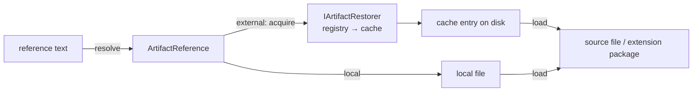
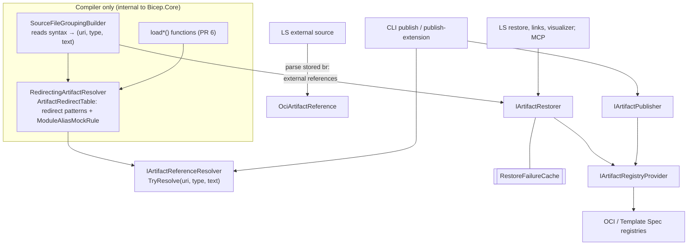

# REP 0022 – Artifact aliases and redirects: implementation plan

Source: Azure/bicep-reps `active/0022-artifact-aliases-and-redirects.md` (tracking issue #19883).
Baseline: `main` @ 31ea91a8a.

---

## 1. Current state (what exists today)

| Concern | Where | Notes |
|---|---|---|
| Reference string → scheme/alias split | `src/Bicep.Core/Registry/ModuleDispatcher.cs` `TryGetArtifactReference(...)` | Splits on the **first** `:`; a `/` in the scheme part means a scheme-qualified alias (`br/alias:`). `avm::x` would currently parse as scheme `avm` + body `:x` → `UnknownModuleReferenceScheme`. |
| Extension name → reference | `ModuleDispatcher.TryGetArtifactAddress` + `SourceFileGroupingBuilder.GetImplicitExtension` | Values without `:` are resolved relative to `config.ConfigFileUri` (the **leaf** config, not the declaring one). |
| Registries | `DefaultArtifactRegistryProvider`: `LocalModuleRegistry` (`""`), `OciArtifactRegistry` (`br`), `OciArtifactMockedRegistry` (`br-mock`), `TemplateSpecModuleRegistry` (`ts`) | `IArtifactRegistryProvider.GetRegistry(scheme)` is keyed on `ArtifactReference.Scheme`. |
| OCI reference | `Registry/Oci/OciArtifactReference.cs`, `OciArtifactAddressComponents.cs`, `OciArtifactReferenceFacts.cs` (`Scheme = "br"`) | `FullyQualifiedReference` = `br:<registry>/<repo>:<tag>`. This string is **persisted**: source archives (`SourceLink/ArchivedSourceFileMetadata.cs`, `SourceArchiveMetadata.cs`), ext-src URIs (`LangServer/.../ExternalSourceReference.cs`, `vscode-bicep/src/features/external-source/external-source-uri.ts`), restore-failure keys. |
| Scheme-qualified module aliases (permanent) | `Configuration/ModuleAliasesConfiguration.cs` (`br`, `ts` maps; alias regex `^[a-zA-Z0-9-_]+$`) | `br/public` lives in built-in `Configuration/bicepconfig.json`. |
| Alias mock | `OciArtifactRegistry.TryParseArtifactReference` → `OciArtifactMockedReference.TryParse` | Uses `DeclaringConfigUri` populated by `BicepConfigurationManager.BuildAliasDeclaringUriMap` (walks the `extends` chain leaf-first). |
| Local file reference | `Modules/LocalModuleReference.cs` | Anchored on referencing file. **`Equals` compares only the relative path string** (not the referencing file) – will be wrong once the same text can resolve to different files. Local extensions are cached content-addressed under `~/.bicep/local/sha256_<digest>`. |
| Source graph | `SourceGraph/SourceFileGroupingBuilder.cs` | `forceRestore` special-cases `Scheme == Local`; cycle detection in `ReportFailuresForCycles`. |
| Data-file loads | `Semantics/Namespaces/SystemNamespaceType.cs` (`TryLoadTextContentFromFile`, `TryLoadTextContentAsBase64`, JSON/YAML builders) → `BicepSourceFile.TryLoadAuxiliaryFile(RelativePath)` | `:` is a forbidden relative-path char (`Bicep.IO/Abstraction/FilePathFacts.cs`), so treating `:`-containing args as artifact references is **non-breaking**. |
| Config chain | `Configuration/BicepConfigurationManager.cs` `BuildChain` | JSON deep-merge of layers; declaring-URI annotation only for `moduleAliasesMock` and `bicep.version`. |
| LS consumers of the dispatcher | `Hover/BicepHoverHandler.cs`, `Definition/BicepDefinitionHandler.cs`, `DocumentLink/BicepExternalSourceRequestHandler.cs`, `Completion/ModuleReferenceCompletionProvider.cs`, `CodeLens/ExternalSourceCodeLensProvider.cs` | Completions hard-code `br:`, `br/`, `ts/`. |
| Linter | `Analyzers/Linter/Rules/*Rule.cs`; `UseRecentModuleVersionsRule` keys off `IOciArtifactReference` + MCR registry | |
| Other `br:` string checks | `Bicep.Cli/Commands/PublishExtensionCommand.cs:136`, `Bicep.Wasm/Interop.cs:242`, `Bicep.McpServer.Core/BicepTools.cs`, `.../WellKnownExtension.cs` | |
| Schema | `src/vscode-bicep/resources/configuration/bicepconfig.schema.json` (`moduleAliases` L240, `moduleAliasesMock` L268, `extensions` L287, linter rules ~L843) | |
| CLI verbosity | No `--verbose` option exists in `Bicep.Cli`. | REP requires redirects be visible in "verbose CLI output". |

---

## 2. Target architecture

### 2.1 One resolver pipeline

Every reference the compiler loads goes through this pipeline (declarations, `extensions` config values, implicit extensions, data-file loads). The LS reads the results from the source graph instead of resolving again (0.2).

```
ArtifactReferenceText (string)
  └─ ArtifactAddress.Parse                          → ArtifactAddress
       Path | SchemeQualified(scheme, body) | SchemeAndAliasQualified(scheme, alias, body) | AliasQualified(alias, body)   (see 2.11)
  ├─ (1) redirect: exact match on source spelling
  ├─ (2) redirect: capture match on source spelling (most literal chars; tie → error)
  ├─ (3) br/<alias> + moduleAliasesMock.br hit → ModuleAliasMockRule → local file (STOP)   [2.11.3]
  ├─ (4) AliasQualified → expand via artifacts.aliases ∪ predefined {mar, avm}  (no I/O)
  ├─     canonicalize through scheme handler (OCI/TS/local parsers)   → CanonicalIdentity
  ├─ (5) redirect: exact match on canonical identity
  ├─ (6) redirect: capture match on canonical identity
  └─ (7) no redirect → ArtifactReference (OciArtifactReference / TemplateSpecModuleReference / LocalArtifactReference)
```

Outputs an `ArtifactResolution` record: `{ SourceText, Parsed, CanonicalIdentity?, Reference, Redirect? }` where `Redirect = { MatchedKey, Phase(Source|Canonical), DeclaringConfigUri, TargetUri }`.

After Phase 0 the pipeline is split in two (2.10.2). Parsing, alias expansion and building the reference (steps 4 and 7) are `IArtifactReferenceResolver`. Redirects and the legacy mock (steps 1–3, 5 and 6) are the compiler-only `RedirectingArtifactResolver`, which wraps the resolver. Publish targets go straight to the resolver, so redirects **cannot** apply to them – by construction, with no flag (otherwise `publish-extension --target oci:…` with a matching redirect would overwrite the local file). The one exception is the legacy mock: `bicep publish` applies `ModuleAliasMockRule` to its target only to keep rejecting mocked aliases, as before REP 0022. Stored ext-src references are fully qualified and are parsed, not resolved.

### 2.2 Parsing rules (`ArtifactAddress.Parse`)

Ordered checks on the raw string:
1. `^(?<alias>[A-Za-z0-9_-]+)::(?<body>.*)$` → `AliasQualified`. (Checked first so `br::x` is alias `br`, not scheme `br`.)
2. `^(?<scheme>br|ts)/(?<alias>[^:]+):(?<body>.*)$` → `SchemeAndAliasQualified` (permanent; resolved only via `moduleAliases`). Any other `<scheme>/<x>:` form (`oci/…`, `file/…`) → new diagnostic "scheme-qualified aliases are not supported for this scheme; use `<alias>::`".
3. `^(?<scheme>[a-z-]+):(?<body>.*)$` → `SchemeQualified` (`oci`, `br`, `ts`, `file`; `br-mock` stays rejected).
4. Otherwise → `Path` (`LocalArtifactReference`).

Body rules: empty body allowed only for OCI alias when body starts with `:`/`@` (the `storage:::0.32.1` form) – validated after expansion; other alias types require non-empty path.

### 2.3 Reference types and identity

| Spelling | Reference type | Restored? | `CanonicalIdentity` |
|---|---|---|---|
| `oci:` / `br:` / `br/alias:` / OCI alias | `OciArtifactReference` (external) | Yes, into `~/.bicep/br/…` | `oci:<registry>/<repo>(:<tag>|@<digest>)` |
| `ts:` / `ts/alias:` / TS alias | `TemplateSpecModuleReference` (external) | Yes | `ts:<sub>/<rg>/<name>:<ver>` |
| relative path / `file:` / file alias / redirect target / mock hit | `LocalArtifactReference` (0.6) | Never | normalized absolute URI |

Every local file is one reference type, whatever its spelling. The spellings differ only in how the text is anchored (relative to the referencing file, a file alias root, or the declaring config file), and that is the resolver's job. Redirects and mocks are recorded as provenance on `ArtifactResolution` (PR 1), not as reference types.

Decisions:
- **Do not change `OciArtifactReferenceFacts.Scheme` / `FullyQualifiedReference`** (`br:`) – it is persisted in source archives, ext-src URIs and cache paths read by older Bicep versions. Add `ArtifactReference.CanonicalIdentity` (virtual) instead; the resolver parses both `br:` and `oci:` into `OciArtifactReference`.
- Diagnostics that print a reference should prefer the user's source spelling where available (`LocalArtifactReference.SourceText`, and `SourceText` on `ArtifactResolution`). Existing diagnostic text must stay byte-identical.
- `LocalArtifactReference.Equals` = `(File, Type)`: `./a.bicep` and `file:./a.bicep` are the same artifact, and `./a.bicep` written in two folders are different artifacts.
- There is no `file` registry. Local references are never restored. A local extension `.tgz` is unpacked on first use into the content-addressed `local/sha256_<digest>` cache, which also satisfies "never stored under the source's remote identity". Publishing a module to a local file is not supported; `publish-extension --target file:…` writes the file, as relative targets do today.
- Module file extension check: `.bicep` / `.json` (and `.bicepparam` only where `using`/`extends` already allows it). Extensions: no extension requirement; validity from `ExtensionV1Archive.Read`.

### 2.4 Configuration model

New `Configuration/ArtifactsConfiguration.cs` bound from top-level `artifacts` (key constant in `BicepConfiguration`):

```csharp
record ArtifactsConfigData {
  ImmutableSortedDictionary<string, ArtifactAlias> Aliases;     // polymorphic on "type"
  ImmutableDictionary<string, string> Redirects;                 // key pattern -> relative target
}
abstract record ArtifactAlias { IOUri? DeclaringConfigUri }      // [JsonIgnore], set by chain builder
record OciArtifactAlias(string Registry, string? RepositoryPrefix);
record TemplateSpecArtifactAlias(string SubscriptionId, string ResourceGroup);
record FileArtifactAlias(string Path);
```

- Binding must **not throw** on semantic errors (a bad alias would otherwise invalidate the whole config via `InvalidBicepConfigFile`). Store per-entry `DiagnosticBuilderDelegate` errors; surface them when an entry is used (matches how `ModuleAliasesConfiguration` errors surface today). Unknown `type` → per-entry error.
- Alias name grammar: reuse `ModuleAliasesConfiguration.ModuleAliasNameRegex()`; case-sensitive (`StringComparer.Ordinal`).
- **Predefined `mar`/`avm` are defined in code** (`PredefinedArtifactAliases`), *not* in built-in `bicepconfig.json`. Reason: `BuildChain` deep-merges JSON, so a user override `{type:"oci", registry:"contoso.azurecr.io"}` would silently inherit the built-in `repositoryPrefix`. Code-defined defaults give whole-entry replacement. Override with `type != "oci"` → error. Defaults are cloud-profile-independent.
- **Declaring URIs:** generalize `BicepConfigurationManager.BuildAliasDeclaringUriMap` into a per-section helper and annotate `artifacts.aliases.*` (file aliases) and `artifacts.redirects.*` with the leaf-most declaring layer. Relative paths resolve against that file’s directory, not the leaf.
- `IBicepConfiguration.Artifacts`, `BicepConfigurationExtensions.With(...)`/`WriteTo` updated so `bicep` config dumping/round-tripping still works.

### 2.5 Redirect engine (`ArtifactRedirectTable`)

- Compile each key once (lazily, cached on the config object) into: literal-char count, capture list, and an internally generated regex (keys are templates, never user regex):
  - `{name}` → `(?<name>[^/:@]+)` (one segment; also must not be `.`/`..`)
  - `{...name}` → `(?<name>[^/:@]+(?:/[^/:@]+)*)`
  - Literal text `Regex.Escape`d. Treat `::` as a delimiter for both capture kinds (excluded since `:` already is).
- Key validation: capture names `^[A-Za-z_][A-Za-z0-9_]*$`, unique, ≤1 multi-segment capture, no `*`/`?`/`**`/`[`; key must itself parse via `ArtifactReferenceSyntaxParser` (with captures replaced by a placeholder) as non-relative.
- Target validation: starts with `./` or `../`; no absolute path; not an artifact reference; every `{x}` declared in the key; after substitution validate with `RelativePath`-equivalent rules (allowing leading `../`), and each captured segment ≠ `.`/`..`, no `\`, no forbidden chars. Resolve against `DeclaringConfigUri`; must be an existing file (not directory) – else "redirect target not found" (no fallback search).
- Matching per phase: exact keys first (dictionary lookup), then all capture keys; pick max literal count; if >1 tie → error diagnostic "ambiguous artifact redirect" listing keys. (REP says "configuration validation fails"; static overlap detection of templates is non-trivial – implement as a resolution-time error on the reference; optionally add a best-effort static check for identical-shape keys. Confirm with REP author.)
- Applied at most once per reference; references inside the target file are resolved fresh (its own closest config), cycles caught by existing `CycleDetector`.

### 2.6 Data-file loads

- In `SystemNamespaceType` load helpers: if the literal contains `:` → resolve through the compiler-only `RedirectingArtifactResolver` (so redirects apply); else unchanged `RelativePath` path. Applies to `loadTextContent`, `loadJsonContent`, `loadYamlContent`, `loadFileAsBase64` (not `loadDirectoryFileInfo`).
- Allowed sources: `file:` and file aliases; redirects on those spellings. `oci:`/`ts:`/OCI/TS alias in a data load → new "artifact reference not supported for file loading" error (REP is silent on redirecting remote identities for data loads – see open questions).
- Add `BicepSourceFile.TryLoadAuxiliaryFile(IOUri)` overload sharing the cache + `referencedAuxiliaryFileUris` tracking (so LS invalidation and the `LoadContentAsBase64ResultBuilder` display path keep working). `BicepSourceFile` needs the resolver/`IFileExplorer` – plumb through `BicepSourceFileFactory`.

### 2.7 `artifact-redirect` analyzer rule

- `Analyzers/Linter/Rules/ArtifactRedirectRule.cs`, `LinterRuleBase`, code `artifact-redirect`, default `Warning`.
- Sources of redirects: `SourceFileGrouping` artifact resolution infos for the model’s file (modules, `using`, `extends`, imports, explicit extensions, config-named extensions, implicit extensions) + load-function literals (re-resolve via the cached resolver).
- Span: the reference string literal (or the identifier for `extension foo`). Message: `"<source>" was redirected to local file "<path>" by "<config>"`.
- Emit once per (file, canonical identity) at first occurrence (REP: "once per redirected artifact during a compilation"; confirm intended granularity vs per-occurrence `#disable-next-line`).
- **Not** emitted for `moduleAliasesMock` hits.
- `UseRecentModuleVersionsRule`: skip redirected references; recognize `avm::`/`mar::` (it already works off the resolved `IOciArtifactReference`, so mostly free) and ensure its code fix preserves the source spelling.

### 2.8 CLI

- Add `--verbose` (or reuse logging) to `build`, `build-params`, `lint`, `restore`, `publish`, `generate-params`; print one stderr line per applied redirect regardless of analyzer level.
- Publish/publish-extension: accept `oci:` and `alias::` targets; reject `file:` for modules; **resolve targets with `IArtifactReferenceResolver.TryResolve`; redirects cannot apply because they live only in the compiler's redirect layer**. Update the `br:`/`ts:` prefix check in `PublishExtensionCommand.cs:136`.
- `restore`: redirected refs are no longer external → nothing to restore (natural).
- `Bicep.Wasm/Interop.cs:242` and MCP `BicepTools.cs` filters: include `oci:`/alias forms.

### 2.9 Language server / VS Code

- Completion (`ModuleReferenceCompletionProvider`): top-level items for `oci:`, `file:`, and each `artifacts.aliases` + `mar::`/`avm::`; reuse existing registry/module/version completion logic by expanding the alias to its OCI location; file-path completion after `file:` and `<fileAlias>::` (reuse the existing local path completion in `BicepCompletionProvider`, re-rooted).
- Same for extension declarations and load-function string args.
- Definition/hover/document links: `LocalArtifactReference` → open the file; redirected OCI → open local file and show "redirected from …" in hover. ext-src `br:` URIs unchanged.
- File watching: redirect targets and alias roots are ordinary source/aux files → existing invalidation; `bicepconfig.json` change already triggers recompilation (verify `artifacts` section is included in the config chain dependency set – it is, as it’s the same file).
- Schema (`bicepconfig.schema.json`): `artifacts.aliases` (`propertyNames` pattern, `oneOf` on `type`: oci/ts/file with required props; `if name in [mar, avm] then type const oci`), `artifacts.redirects` (`additionalProperties: { pattern: "^\\.\\.?/" }`), `analyzers.core.rules.artifact-redirect`.

---

## 2.10 Phase 0 – Refactor artifact references, resolution and dispatching (no behavior change)

Goal: make the REP work additive. Every Phase 0 PR must leave **all baselines and test expectations unchanged** (except tests that only exercise renamed types). `Azure.Bicep.Core` is published to nuget.org but explicitly unsupported ("we reserve the right to push breaking changes"), so renames are fine.

### 2.10.1 Problems found (evidence)

| # | Problem | Evidence | Why it blocks REP 0022 |
|---|---|---|---|
| P1 | **`IModuleDispatcher` is a god object with a misleading name.** It is a reference factory (`IArtifactReferenceFactory`), a registry router, a restore orchestrator with a 30-min failure cache, a cache-path lookup (`TryGetLocalArtifactEntryPointFileHandle`), and a publisher. It handles extensions, Template Specs, `using`/`extends`/`import`, not only modules. Interface declared in `IArtifactDispatcher.cs`, class `ModuleDispatcher`, tests in `ArtifactDispatcherTests.cs`. | `Registry/IArtifactDispatcher.cs:22`, `Registry/ModuleDispatcher.cs` | Resolution gains alias/redirect logic; mixing it with restore/publish makes "don't redirect publish targets" an option flag instead of a type boundary. |
| P2 | **References are resolved many times instead of once.** `SourceFileGrouping.ArtifactLookup` already stores the `ArtifactReference` per syntax, yet `Compilation`/`SemanticModel`/`SymbolContext` carry an `IArtifactReferenceFactory` so `ImportedSymbol`/`WildcardImportSymbol` re-resolve (`ImportClosureInfo.cs:255,265`), and the LS re-resolves in `BicepDefinitionHandler.cs:108,119,132,212,472` and `BicepHoverHandler.cs:231`. (They pass the correct referencing file today – the active document is the compilation entry point – so this is duplicated work, not a bug.) | grep `ArtifactReferenceFactory`, `moduleDispatcher.TryGetArtifactReference` | With aliases/redirects, any second resolution path can drift from what the compiler used. REP requires "the compiler and language server use the same resolver so build, diagnostics, completion, and navigation do not disagree". |
| P3 | **Registries parse.** `IArtifactRegistry.TryParseArtifactReference(referencingFile, artifactType, aliasName, text)`; alias expansion lives in `OciArtifactReference.TryParseComponents` / `TemplateSpecModuleReference.TryParse`; mock lives in `OciArtifactRegistry.TryParseArtifactReference`. Splitting text is in `ModuleDispatcher.TryGetArtifactReference` (first `:` then `/`), and the extension-config path has its own rules (`TryGetArtifactAddress`). | `Registry/IArtifactRegistry.cs:34`, `OciArtifactRegistry.cs:65-110`, `ModuleDispatcher.cs:39-139` | The REP's ordered pipeline (source redirect → mock → alias → canonicalize → canonical redirect) must cut across all schemes. |
| P4 | **Scheme string is overloaded.** `ArtifactReference.Scheme` is the registry routing key, the display prefix and (for OCI) the persisted prefix (`br:` in source archives / ext-src URIs / cache path `~/.bicep/br/...`). `br-mock` exists only so the dispatcher can route a mock reference to `OciArtifactMockedRegistry`, whose parse method just errors. `ArtifactReferenceSchemes` lives in `Modules/ModuleReferenceSchemes.cs`. | `Modules/ModuleReferenceSchemes.cs`, `OciArtifactMockRegistry.cs`, `BicepRegistryArtifact.cs:52` | Adding `oci`/`file` and canonical identity on top of an overloaded string is error-prone. |
| P5 | **`LocalModuleReference` is overloaded and has wrong identity.** Covers modules *and* extensions (TODO L21); for extensions its "entry point" is the cached `types.tgz` (TODO L86); anchored on `referencingFile`; `Equals` compares only the relative string, so `./a.bicep` from two different folders are "equal" (matters for `RestoreArtifacts` `Distinct()` and restore-failure keys). `OciArtifactMockedReference` is a second local-file reference type. | `Modules/LocalModuleReference.cs` | `file:`, file aliases and redirect targets are local files anchored elsewhere (config dir) – needs a URI-anchored type. |
| P6 | **"Artifact" means two things.** `SourceGraph/Artifacts/*` (`ExternalArtifact`, `BicepRegistryArtifact`, `LocalExtensionArtifact`, `TemplateSpecModuleArtifact`) are actually **cache-directory layouts**, not artifacts. `ExternalArtifactRegistry` really means "registry backed by the local cache". | `SourceGraph/Artifacts/*.cs`, `Registry/ExternalArtifactRegistry.cs` | Confusing vocabulary once "artifact" also means alias/redirect target. |
| P7 | **Registry interface mixes concerns.** `IArtifactRegistry` has parse, restore, invalidate, publish, exists, capabilities, `GetDocumentationUri`, and `TryGetModuleDescription(ModuleSymbol, …)` (semantic type leaking into the registry; used only by hover). | `Registry/IArtifactRegistry.cs` | Not blocking, but every new reference kind must implement all of it. |
| P8 | **References carry ambient services.** `ArtifactReference` holds `IFeatureProvider` + `IBicepConfiguration`; registries read `reference.Configuration.Cloud` (auth session, restore-failure key), `reference.FeatureProvider.CacheRootDirectory`, `.OciEnabled`. | `ArtifactReference.cs`, `OciArtifactRegistry.cs:312,557,609`, `ModuleDispatcher.cs:164-258` | Muddies "identity"; but each reference is legitimately per-file-config. Narrow, don't remove (see 0.8). |
| P9 | **Scattered folders/namespaces.** `Bicep.Core.Modules` (Local/TemplateSpec refs, schemes, `OciModuleArtifactResult`), `Bicep.Core.Registry` (+`Oci`, `Providers`, `Catalog`), `SourceGraph/Artifacts`, `SourceGraph/ArtifactReferences` (one interface). | directory listing | Discoverability. |

### 2.10.2 Replacing `ModuleDispatcher`: resolve, acquire, load, publish

"Dispatcher" describes an internal mechanism (routing by scheme), and "Module" is wrong (extensions, Template Specs, `using`/`extends`/`import`). `IModuleDispatcher` answers several unrelated questions. **Decision:** give each question its own owner.

| Question | Owner | Callers | State |
|---|---|---|---|
| What artifact does this text name? | `IArtifactReferenceResolver` | The compiler's redirect layer, CLI publish commands, test helpers | None |
| What should the compiler load for this dependency? | `RedirectingArtifactResolver` (compiler only) | `SourceFileGroupingBuilder`; later the `load*()` functions (PR 6) | None |
| Is this remote artifact in the cache, and can we download it? | `IArtifactRestorer` | `BicepCompiler`, source graph, LS (restore scheduler, force restore, document links, visualizer), MCP | Recent restore failures (30 min) |
| Can we push it to a registry? | `IArtifactPublisher` | CLI publish commands, test helpers | None |
| How do we read what is on disk? | Loading: the source graph and the extension loader, reading a local file or a cache entry | Compiler | None |

Design rules:
- **Resolution has one method.** The resolver takes reference text, where it was written and the expected artifact type, and returns the artifact it names (parse, expand aliases, build the reference). It does not:
  - *read Bicep syntax* – the source graph extracts the text from `module`/`import`/`using`/`extends`/`extension` declarations (including the `extensions` config lookup for `extension foo`) and calls the resolver;
  - *read stored references* – `br:` strings in ext-src URIs are fully qualified and are parsed directly (as `ExternalSourceReference.ToArtifactReference` does), because aliases, relative paths and redirects never apply to them;
  - *apply redirects or mocks* – they change what the compiler loads, not what the text names, so they live in the compiler-only redirect layer. Publish targets never reach that layer and so can never be redirected. (`bicep publish` applies only the legacy mock rule, so that a mocked alias stays an invalid target.)
- **Acquiring and loading are separate.** Restoring downloads a remote artifact into the local cache; only `ExternalArtifactReference`s (OCI and Template Specs) are ever restored, and the restorer's signatures enforce it. Loading reads what is on disk – a local file or a cache entry – the same way for both. Local references, including `file:`, file aliases and redirect targets, never reach the restorer; a local extension `.tgz` is unpacked on first use.
- **Restore and publish are separate services.** They have different callers, only the restorer keeps state, and finding the registry for a reference is already `IArtifactRegistryProvider`'s job. Compiler and LS code does not depend on publish operations.
- **Objects carry their own facts.** Every `ArtifactReference` knows its `ArtifactType`, so services take no separate type argument and there are no module/extension method pairs. Whether a reference is local or external is its type, not a flag.
- **Variation is modelled with types.** Restore states and publish payloads are small type hierarchies. The legacy mock and redirect patterns are subclasses of one redirect-rule type, so deleting the mock means deleting one class.

Related renames (0.7):
- `SourceGraph/Artifacts/ExternalArtifact` & subclasses → `Artifacts/Cache/*CacheEntry` (`OciCacheEntry`, `OciModuleCacheEntry`, `OciExtensionCacheEntry`, `TemplateSpecCacheEntry`, `LocalExtensionCacheEntry`); `IExtensionArtifact` → `IExtensionCacheEntry`.
- `ExternalArtifactRegistry<,>` → `CachedArtifactRegistry<,>`.
- `ArtifactReferenceSchemes` → `ArtifactSchemes` in its own file; becomes **text-only** constants (what users type).
- `ArtifactResolutionInfo` → keep name (now accurate) but add `Resolution` details (PR 1).

### 2.10.3 Target model after Phase 0





```
Bicep.Core/Artifacts/
  ArtifactType.cs, ArtifactSchemes.cs
  References/   ArtifactReference (abstract), ExternalArtifactReference (abstract), OciArtifactReference,
                TemplateSpecArtifactReference, LocalArtifactReference
  Resolution/   ArtifactAddress (+ parser), IArtifactReferenceResolver, ArtifactReferenceResolver
  Redirects/    RedirectingArtifactResolver, ArtifactRedirectTable, ArtifactRedirectRule (+ PatternRedirectRule in PR 7)
  LegacyModuleAliasMocks/  ModuleAliasMockRule
  Restore/      IArtifactRestorer, ArtifactRestorer, ArtifactRestoreState, RestoreMode, RestoreFailureCache
  Publish/      IArtifactPublisher, ArtifactPublisher, ArtifactPackage, ModulePackage, ExtensionPackage
  Registries/   IArtifactRegistry, IArtifactRegistryProvider, OciArtifactRegistry, TemplateSpecArtifactRegistry,
                CachedArtifactRegistry<,>
  Cache/        *CacheEntry (on-disk layout of restored artifacts and unpacked local extensions)
  Oci/ …        (existing OCI transport/manifest code moves under Artifacts/Oci or stays in Registry/Oci – decide in 0.7)
```

Key contracts (final shape; comments say which phase introduces what):

```csharp
// Pure, no I/O, no config.
abstract record ArtifactAddress(string Text) {
  record Path();                                           // ./mod.bicep
  record SchemeQualified(string Scheme, string Body);      // br:, ts:  (later oci:, file:)
  record SchemeAndAliasQualified(string Scheme, string Alias, string Body); // br/x:, ts/x: (permanent, moduleAliases)
  // PR 1: record AliasQualified(string Alias, string Body); // x::
  static ArtifactAddress Parse(string text);              // total: never fails
}

abstract class ArtifactReference {
  ArtifactType Type;                             // 0.5: on the base class
  string FullyQualifiedReference;                // persisted/display form – unchanged ("br:…", "ts:…", relative path)
  // PR 1 adds: string CanonicalIdentity
}

// Remote artifacts; must be restored before they can be loaded. 0.5.
abstract class ExternalArtifactReference : ArtifactReference { }   // OciArtifactReference, TemplateSpecModuleReference

// Any file on disk: relative paths, file:, file aliases, redirect targets, mock hits. 0.6.
sealed class LocalArtifactReference : ArtifactReference {
  IOUri File;          // resolved and anchored by the resolver
  string SourceText;   // spelling, for display: "./x.bicep", "file:./x.bicep", "lib::x.bicep"
  // Equals: (File, Type)
}

public interface IArtifactReferenceResolver
{
    // 0.5 takes a BicepSourceFile; 0.6 switches to IOUri once local references are URI-anchored.
    ResultWithDiagnosticBuilder<ArtifactReference> TryResolve(IOUri referencingUri, ArtifactType type, string reference);
}

public sealed class RedirectingArtifactResolver(IArtifactReferenceResolver resolver)
{
    // Rules on the text first (redirect patterns, then the legacy mock), then resolve,
    // then rules on the resolved reference. PR 1 returns ArtifactResolution (reference + provenance).
    public ResultWithDiagnosticBuilder<ArtifactReference> TryResolve(IOUri referencingUri, ArtifactType type, string reference);
}

public interface IArtifactRestorer          // 0.6: external references only
{
    ArtifactRestoreState GetRestoreState(ExternalArtifactReference reference);

    /// <returns><c>true</c> if anything was downloaded and the caller should recompile.</returns>
    Task<bool> RestoreAsync(IEnumerable<ExternalArtifactReference> references, RestoreMode mode);
}

public enum RestoreMode { IfMissing, Force }

public abstract record ArtifactRestoreState
{
    private ArtifactRestoreState() { }

    public sealed record Restored : ArtifactRestoreState;            // 0.8: carries the cache entry that loading reads
    public sealed record NotRestored : ArtifactRestoreState;
    public sealed record RestoreFailed(DiagnosticBuilder.DiagnosticBuilderDelegate Error) : ArtifactRestoreState;
}

public interface IArtifactPublisher
{
    bool CanPublish(ArtifactReference target);
    Task<bool> ExistsAsync(ArtifactReference target);
    Task PublishAsync(ArtifactReference target, ArtifactPackage package);   // throws if target.Type != package.Type
}

public abstract record ArtifactPackage { public abstract ArtifactType Type { get; } }
public sealed record ModulePackage(BinaryData Template, BinaryData? Sources, string? DocumentationUri) : ArtifactPackage;
public sealed record ExtensionPackage(BinaryData Types, bool LocalDeployEnabled, ImmutableArray<ExtensionBinary> Binaries) : ArtifactPackage;

// One per remote protocol (OCI, Template Specs). No parsing. Routed by reference type.
interface IArtifactRegistry {
  bool IsRestoreRequired(ExternalArtifactReference); Task<…> Restore(…); Task<…> InvalidateCache(…);
  bool CanPublish(ExternalArtifactReference); Task Publish(ExternalArtifactReference, ArtifactPackage); Task<bool> Exists(ExternalArtifactReference);
}
```

The source graph makes one local-or-external decision per reference (0.6):

```csharp
var file = reference switch
{
    LocalArtifactReference local => Load(local.File),
    ExternalArtifactReference external => restorer.GetRestoreState(external) switch
    {
        ArtifactRestoreState.Restored => LoadFromCache(external),
        ArtifactRestoreState.NotRestored => RequiresRestore(external),
        ArtifactRestoreState.RestoreFailed failed => new(failed.Error),
    },
};
```

- Registries are routed by reference type instead of scheme strings (0.6), which deletes the `br-mock` scheme and `OciArtifactMockedRegistry`. A mock hit becomes a `LocalArtifactReference` whose display text is still `br:…`. Keep the `br-mock:` rejection diagnostic (`ModuleReferenceSchemeBrFsNotSupported`) as a parser rule so the text behavior is unchanged.
- Publishing an extension to a local file is done by the publisher (`ExtensionV1Archive.Build` + write); there is no local registry.
- Locating files on disk belongs to cache entries, which own the on-disk layout; references stop computing their own entry points (0.8).
- Hover-only metadata (`GetDocumentationUri`, `TryGetModuleDescription(ModuleSymbol, …)`) moves off `IArtifactRegistry` into an `IArtifactMetadataProvider` used by hover (0.7).
- `CancellationToken` on restore/publish and registry methods (0.8).

### 2.10.4 Phase 0 PRs

| # | PR | Details | Verification |
|---|---|---|---|
| 0.1 ✅ | **Characterization tests** (done) | `Bicep.Core.UnitTests/Registry/ArtifactReferenceResolutionTests.cs` pins end-to-end resolution through the real `ModuleDispatcher`, registries and config discovery (the existing body-parser tests in `Modules/*ReferenceTests.cs` already cover OCI/TS body validation): relative paths (incl. `\`, absolute, `C:/…` treated as scheme `C`, empty), `br:` (casing, digest, port, missing tag, uppercase repo), `br/public:`, `br/<alias>:` (missing, invalid name, empty name, no registry, no modulePath), moduleAliasesMock (tag, digest, invalid segment), `br-mock:`, `ts:` + `ts/<alias>:`, unknown schemes and REP 0022 spellings (`oci:`, `file:`, `avm::`, `br::`, `oci/x:`) as they fail today, extension text, `extension <name>` via the `extensions` map (bare path rewritten relative to the referencing file), implicit extensions (bare path anchored on the referencing file – an inconsistency to resolve in 0.3), and the `LocalModuleReference.Equals` behavior expected to change in 0.6. | New tests green on `main`. |
| 0.2 ✅ | **Single source of truth for resolved references** (done) | Remove `IArtifactReferenceFactory` from `Compilation`, `SemanticModel`, `ISymbolContext`/`SymbolContext`; `ImportedSymbol`/`WildcardImportSymbol.TryGetArtifactReference()` read `SourceFileGrouping.ArtifactLookup[EnclosingDeclaration].Reference`; LS `BicepDefinitionHandler`/`BicepHoverHandler` read the lookup instead of re-resolving with `EntryPoint`. Expose a helper `IArtifactFileLookupExtensions.TryGetArtifactReference(IArtifactReferenceSyntax)`. | No behavior change; baselines unchanged. |
| 0.3a ✅ | **`ArtifactAddress` parser + `ArtifactReferenceResolver`** (done) | Pure, total parser `ArtifactAddress.Parse` (`Path` / `SchemeQualified` / `SchemeAndAliasQualified`; originally named `Relative` / `Qualified` / `SchemeQualifiedAlias`) replaces the string splitting in `ModuleDispatcher.TryGetArtifactReference`. `ArtifactReferenceResolver` (implements `IArtifactReferenceFactory`) takes over text/syntax → reference resolution, including the extension declaration / `extensions` map path; `ModuleDispatcher` delegates to it. Registries still parse bodies and expand aliases. | 0.1 tests unchanged (plus parser edge cases pinned before the change). |
| 0.3b ✅ | **Alias expansion + mock isolation in the resolver** (done) | `ArtifactReferenceResolver` now builds references itself: it expands scheme-qualified aliases through `moduleAliases` (`TryExpandSchemeQualifiedAlias`) and dispatches to the OCI/TS/local body parsers. `OciArtifactReference.TryParse`/`TemplateSpecModuleReference.TryParse` only parse a fully qualified body (the alias is passed as a diagnostic-only `aliasContext`). The mock moved from `OciArtifactRegistry` into `internal` `Artifacts/LegacyModuleAliasMocks/ModuleAliasMockResolver` (which also owns `OciArtifactMockedReference` creation), called once before alias expansion; `OciArtifactRegistry` no longer takes an `IFileExplorer`. `TryParseArtifactReference` removed from `IArtifactRegistry`. Declaring-URI annotation generalized to `FindDeclaringUrisByKey(rawLayers, sectionPath)`. Mock architecture test `ModuleAliasMockIsolationTests` added (2.11.3). Implicit extensions already resolve through the resolver's text overload; whether bare paths are config-relative stays open (question 11) because changing it is a behavior change. `.gitignore`: un-ignore `src/*/Artifacts/` (the template's `artifacts/` rule matches it on case-insensitive file systems). Mock config types stay in `Configuration/` until 0.7. 0.5 later moves the mock out of the resolver into the compiler-only redirect layer. | 0.1 tests unchanged (diagnostic text byte-identical); architecture test green (and fails when a reference is planted outside the allowed files). |
| 0.4 ✅ | **Split `ModuleDispatcher` into resolver, restorer and publisher** (done) | Mechanical split; signatures stay as close to today's as possible. `IArtifactReferenceResolver` = today's `IArtifactReferenceFactory` renamed (`TryResolve(file, type, text)`, `TryResolve(file, syntax)`). `IArtifactRestorer`/`ArtifactRestorer` owns the restore-failure cache: `GetRestoreStatus`, `TryGetEntryPoint`, `RestoreArtifacts`, `PruneRestoreStatuses`. `IArtifactPublisher`/`ArtifactPublisher` is stateless: `CanPublish(type, ref)`, `ModuleExists`, `ExtensionExists`, `PublishModule`, `PublishExtension`. Delete `IModuleDispatcher`, `ModuleDispatcher` and `IArtifactReferenceFactory`. Migrate the compiler, source graph, CLI, LS (including the visualizer), MCP, Wasm and test helpers; DI in `AddBicepCore`. Tests: `ArtifactRestorerTests`, `ArtifactPublisherTests`. | Full test suite; CLI publish integration tests; baselines unchanged. |
| 0.5 ✅ | **Clean up the artifact service APIs** (done) | (1) `ArtifactReference.Type` on the base class (replaces `LocalModuleReference.ArtifactType` and moves `OciArtifactReference.Type` up; Template Spec → `Module`). (2) `ExternalArtifactReference` base class for `OciArtifactReference` and `TemplateSpecModuleReference`; remove the `IsExternal` flag. (3) Resolver: one `TryResolve(BicepSourceFile, ArtifactType, string)`; the source graph extracts the text from syntax, including the `extensions` config lookup (keep today's bare-path behavior; see question 11). (4) The ext-src request handler parses the stored `br:` reference directly, as `ExternalSourceReference.ToArtifactReference` does. (5) Compiler-only `RedirectingArtifactResolver` + `ArtifactRedirectTable`; `ModuleAliasMockResolver` becomes `ModuleAliasMockRule`, the table's only rule until PR 7. (6) Restorer: `GetRestoreState` → `ArtifactRestoreState` (`Restored`/`NotRestored`/`RestoreFailed`) and `RestoreAsync(refs, RestoreMode)`; the failure cache becomes an internal `RestoreFailureCache` that drops expired entries after each restore, so `PruneRestoreStatuses` is removed. (7) Publisher: `CanPublish(ref)`, `ExistsAsync(ref)`, `PublishAsync(ref, ArtifactPackage)` with `ModulePackage`/`ExtensionPackage`. No behavior change: publish targets do not go through the redirect table, but `bicep publish` applies `ModuleAliasMockRule` before resolving its target, so a mocked `br/<alias>:` target still fails with "target not supported" (even if the alias is also in `moduleAliases`). `publish-extension` treats `br/<alias>:` targets as file paths, so it needs no check. Implementation notes: syntax-to-text extraction lives in the internal `SourceGraph/ArtifactReferenceText`; `SourceFileGroupingBuilder` wraps the injected resolver in `RedirectingArtifactResolver` (so the resolver no longer takes an `IFileExplorer`); `IArtifactRestorer.TryGetEntryPoint` stays until 0.8; the LS force-restore summary keeps its `Succeeded`/`Failed`/`Unknown` text; the new types are `public`, like the rest of Bicep.Core (a Core-wide visibility review is out of scope). | Full test suite; mock tests unchanged; new CLI tests pin alias and mocked-alias publish targets; mock architecture test updated for the new call sites; baselines unchanged. |
| 0.6 | **Local references** | One `LocalArtifactReference(File, Type, SourceText)` replaces `LocalModuleReference` and `OciArtifactMockedReference`; `Equals` by `(File, Type)`. The resolver takes `IOUri` instead of `BicepSourceFile`, so callers stop creating dummy source files (`CreateDummyArtifactReferencingFile`, CLI publish commands). The restorer accepts only `ExternalArtifactReference`. Local extension `.tgz` files are unpacked on first use (content-addressed `local/sha256_…` layout unchanged), so `LocalModuleRegistry` is deleted and publishing an extension to a local file moves to the publisher. The source graph makes one local-or-external decision, which removes the `Scheme == ""` special case for forced restore. Delete `OciArtifactMockedRegistry` and the `br-mock` scheme; registries are routed by reference type. **Behavior change:** local extensions no longer need a restore, so `--no-restore` builds and the LS before its first restore load them. `bicep restore --force` no longer re-unpacks local extensions (the cache is content-addressed), and the LS force-restore summary lists only remote artifacts. Unpacking keeps the existing lock and atomic write so concurrent LS/CLI compilations are safe. | Mock tests unchanged; restore-dedup test flipped to correct behavior; diagnostic text byte-identical (display uses `SourceText`); local extension without restore. |
| 0.7 | **Vocabulary + folders** | Move to `Bicep.Core/Artifacts/*` namespaces; mock config types to `Configuration/LegacyModuleAliasMocks/`; cache-entry renames; `IArtifactMetadataProvider` for hover metadata; split `ModuleReferenceCompletionProvider` into prefix parsing + catalog completion, with alias prefixes (`br/x:`, `ts/x:`, later `x::`) supplied by `IArtifactAliasCatalog`. Mostly mechanical; land last to minimize rebase pain. | Build + full tests; LS completion tests unchanged. |
| 0.8 | *(optional, time-boxed)* **Narrow ambient state; cache owns the on-disk layout** | Replace `IFeatureProvider` + `IBicepConfiguration` on references with a small `ArtifactRegistryContext(CloudConfiguration Cloud, IDirectoryHandle CacheRoot, bool OciEnabled)` captured at resolve time; restore-failure key = (Cloud, Reference). Cache entries own locating files on disk: `ArtifactRestoreState.Restored` carries the cache entry, and `ArtifactReference.TryGetEntryPointFileHandle` and `IArtifactRestorer.TryGetEntryPoint` are removed. Optionally split `CachedArtifactRegistry<,>` into a remote client (pull, push, exists) and an artifact cache (read and write entries), with the restorer combining them. Thread `CancellationToken` through restore, publish and registries. Skip parts that grow beyond a mechanical change. | Full tests. |

Dependencies: 0.2 is independent (it changes no parsing/resolution logic) and landed first; 0.1 → 0.3a → 0.3b → 0.4 → 0.5 → 0.6 → 0.7 → 0.8.

Risks / mitigations:
- *Persisted strings*: `FullyQualifiedReference` for OCI stays `br:…`; cache paths (`~/.bicep/br/...`, `local/sha256_…`, TS layout) unchanged – add a test asserting cache directory paths.
- *LS performance*: 0.2 reduces work (no re-resolution per hover/definition).
- *Wasm/MCP*: both construct their own registry providers – include in 0.4–0.6 builds.
- *Scope creep*: 0.8 and the `Registry/Oci` move are explicitly optional.

### 2.10.5 Phase 0.4 validation

The package feed used for validation has no Scriban 7.5.3 (latest 7.5.1) or Markdig 1.5.0 (latest 1.4.2), and nuget.org was unreachable. The runs below used a temporary local Scriban 7.5.1 override, which was reverted; the committed pin stays at 7.5.3. Re-run with the pinned versions in CI.

| Command | Result |
|---|---|
| `dotnet build Bicep.slnx --no-restore` | 0 warnings; only the four RegistryModuleTool projects fail, because Markdig 1.5.0 is unavailable |
| `dotnet test --project src\Bicep.Core.UnitTests\Bicep.Core.UnitTests.csproj --no-build` | Passed: 7,459 |
| `dotnet test --project src\Bicep.Core.IntegrationTests\Bicep.Core.IntegrationTests.csproj --no-build` | Passed: 3,507 (baselines unchanged) |
| `dotnet test --project src\Bicep.Cli.UnitTests\Bicep.Cli.UnitTests.csproj --no-build` | Passed: 85 |
| `dotnet test --project src\Bicep.Cli.IntegrationTests\Bicep.Cli.IntegrationTests.csproj --no-build` | Passed: 1,166 (includes module and extension publish) |
| `dotnet test --project src\Bicep.LangServer.UnitTests\Bicep.LangServer.UnitTests.csproj --no-build` | Passed: 906 |
| `dotnet test --project src\Bicep.LangServer.IntegrationTests\Bicep.LangServer.IntegrationTests.csproj --no-build` | Passed: 2,062 |
| `dotnet test --project src\Bicep.Wasm.UnitTests\Bicep.Wasm.UnitTests.csproj --no-build` | Passed: 11 |
| `dotnet test --project src\Bicep.McpServer.UnitTests\Bicep.McpServer.UnitTests.csproj --no-build` | Passed: 95 |

### 2.10.6 Phase 0.5 validation

No behavior change. New CLI tests pin existing publish-target behavior: `bicep publish --target br/<alias>:…` publishes through `moduleAliases`, and a mocked alias is rejected with "target not supported".

| Command | Result |
|---|---|
| `dotnet build Bicep.slnx --no-restore` | 0 warnings; only the four RegistryModuleTool projects fail, because Markdig 1.5.0 is unavailable |
| `dotnet test --project src\Bicep.Core.UnitTests\Bicep.Core.UnitTests.csproj --no-build` | Passed: 7,462 |
| `dotnet test --project src\Bicep.Core.IntegrationTests\Bicep.Core.IntegrationTests.csproj --no-build` | Passed: 3,507 (baselines unchanged) |
| `dotnet test --project src\Bicep.Cli.UnitTests\Bicep.Cli.UnitTests.csproj --no-build` | Passed: 85 |
| `dotnet test --project src\Bicep.Cli.IntegrationTests\Bicep.Cli.IntegrationTests.csproj --no-build` | Passed: 1,169 |
| `dotnet test --project src\Bicep.LangServer.UnitTests\Bicep.LangServer.UnitTests.csproj --no-build` | Passed: 906 |
| `dotnet test --project src\Bicep.LangServer.IntegrationTests\Bicep.LangServer.IntegrationTests.csproj --no-build` | Passed: 2,062 |
| `dotnet test --project src\Bicep.Wasm.UnitTests\Bicep.Wasm.UnitTests.csproj --no-build` | Passed: 11 |
| `dotnet test --project src\Bicep.McpServer.UnitTests\Bicep.McpServer.UnitTests.csproj --no-build` | Passed: 95 |

Next: 0.6.

---

## 2.11 Permanent vs. deletable reference formats

**Decision:** only `moduleAliasesMock` is deletable. Every source-reference syntax customers have written is supported forever, because a migration can't realistically be required. So:
- Permanent syntaxes are **first-class core forms**. They are not plugins or "legacy" code.
- Only the mock is isolated, so it can be removed without touching shared logic.

### 2.11.1 Classification

| Format / feature | Status |
|---|---|
| `br:<registry>/<repo>:<tag>` | **Permanent**. Persisted in source archives, ext-src URIs and the `~/.bicep/br` cache. Another spelling of `oci:`. |
| `ts:<sub>/<rg>/<name>:<ver>` | **Permanent**. Core scheme. |
| `br/public:` | **Permanent**. Predefined scheme-qualified alias. |
| `br/<alias>:` with `moduleAliases.br` | **Permanent**. Scheme-qualified alias. |
| `ts/<alias>:` with `moduleAliases.ts` | **Permanent**. Scheme-qualified alias. |
| `oci:`, `file:`, `<alias>::`, `artifacts.*` | **Permanent**. New in REP 0022. |
| Relative paths; `extensions` map values (with a scheme or a bare path) | **Permanent**. |
| `moduleAliasesMock` (`mapToFilePath`, absolute roots, `OciArtifactMockedReference`) | **Deletable**. Superseded by `artifacts.redirects`. |
| `br-mock:` scheme | Internal artifact, removed in Phase 0.6. |

Terminology for code and docs: avoid calling the permanent forms "legacy". The `Legacy` prefix is used **only** for the internal code location of the deletable mock (`LegacyModuleAliasMocks` folders and namespaces), never in user-facing text (config key, schema, diagnostics, docs); class names inside it are not prefixed (e.g. `LegacyModuleAliasMocks.ModuleAliasMockResolver`).
- **Scheme-qualified aliases** (`br/<alias>:`, `ts/<alias>:`, backed by `moduleAliases`).
- **Artifact aliases** (`<alias>::`, backed by `artifacts.aliases` and the predefined `mar`/`avm`).

The two namespaces stay independent, as the REP requires.

### 2.11.2 Core address model (both alias forms first-class)

```csharp
abstract record ArtifactAddress(string Text)
{
    record Path();                                                         // ./mod.bicep
    record SchemeQualified(string Scheme, string Body);                    // br:, oci:, ts:, file:
    record SchemeAndAliasQualified(string Scheme, string Alias, string Body); // br/<alias>:, ts/<alias>:   (moduleAliases)
    record AliasQualified(string Alias, string Body);                      // <alias>::                  (artifacts.aliases)
}
```

- The parser recognizes `br/<alias>:` and `ts/<alias>:` directly. Other `<scheme>/<x>:` forms (`oci/…`, `file/…`) get the "scheme-qualified aliases are not supported for this scheme; use `<alias>::`" diagnostic.
- The resolver's alias-expansion step has two **separate** lookups, one per address form:
  - `SchemeAndAliasQualified` → `IBicepConfiguration.ModuleAliases`
  - `AliasQualified` → `IBicepConfiguration.Artifacts.Aliases` plus predefined aliases

  Each produces `(scheme, body, aliasContext)` for the core OCI/TS/File body parsers, so there is no fallback between the maps. The OCI and Template Spec reference types no longer read config (alias lookup moves out of `OciArtifactReference.TryParseComponents` and `TemplateSpecModuleReference.TryParse`).
- `aliasContext` feeds the existing "…after resolving alias "X" is not valid" diagnostics for both alias forms.
- Language server completion uses one core `IArtifactAliasCatalog` that lists both kinds of prefix (`br/x:`, `ts/x:`, `x::`) with their expanded locations. The registry/module/version catalog completion is shared.

### 2.11.3 Isolating `moduleAliasesMock`

Today the mock is spread through shared code:
- `OciArtifactRegistry.TryParseArtifactReference`: mock lookup and `OciArtifactMockedReference` creation inside the core OCI registry.
- `OciArtifactMockedReference`, `OciArtifactMockedRegistry`, and the `br-mock` scheme in `ArtifactReferenceSchemes`.
- `BicepConfigurationManager.BuildAliasDeclaringUriMap`: declaring-URI annotation hard-coded for `moduleAliasesMock.br`.

Target layout:
- **`Bicep.Core/Artifacts/LegacyModuleAliasMocks/ModuleAliasMockRule`** owns all mock behavior. It is one rule in the compiler-only `ArtifactRedirectTable` (from 0.5). It matches a `SchemeAndAliasQualified` address with scheme `br` and returns one of:
  - `null`: no mock configured for this alias
  - a failure: today's diagnostics, including "modules only"
  - a local file URI plus a display reference `br:<modulePath>`

  It keeps today's rules unchanged: absolute and relative roots, the `.bicep` suffix, tag/digest ignored, and paths anchored to the declaring config file.
- **One registration:** `ArtifactRedirectTable` evaluates it at REP step 3, after the source-spelling redirect patterns and before alias expansion. A hit is terminal: it produces a `LocalArtifactReference` with provenance `ModuleAliasMock`, and canonical redirects are skipped. The `artifact-redirect` rule ignores this provenance. Publish targets never go through the table; `bicep publish` applies this rule directly, only so that a mocked alias stays an invalid target as it was before REP 0022.
- **Config:** `ModuleAliasesMockConfiguration` and related types move to `Configuration/LegacyModuleAliasMocks/`. The generalized declaring-URI annotation (also used by `artifacts.aliases` and `artifacts.redirects`) registers `moduleAliasesMock.br` as one entry.
- **Diagnostics** stay in `DiagnosticBuilder` as they are.
- **Tests:** mock tests are grouped in `Bicep.Core.UnitTests/Artifacts/LegacyModuleAliasMocks/` and `Bicep.Core.IntegrationTests/LegacyModuleAliasMocks/`. This includes the existing `OciArtifactMockedReferenceTests` and the mock cases in `ConfigurationInheritanceTests`.
- **Guardrail:** an architecture test checks that only the redirect table's rule registration, the CLI `publish` command, the config binding (`BicepConfiguration` and `BicepConfigurationExtensions`), and the mock folder reference `Bicep.Core.Artifacts.LegacyModuleAliasMocks` / `ModuleAliasesMock`.

Deletion checklist (to put in a code comment on `ModuleAliasMockRule`):
- the `LegacyModuleAliasMocks` folders in product code and tests
- the rule registration in `ArtifactRedirectTable`
- the call in the CLI `publish` command
- the `ModuleAliasesMock` property and its bind/`With`/`WriteTo` code, plus its declaring-URI registration
- the `moduleAliasesMock` placeholder in built-in `bicepconfig.json` and in the schema
- now-unused diagnostic methods (BCP codes stay reserved)
- optionally, a "`moduleAliasesMock` is no longer supported; use `artifacts.redirects`" config diagnostic

Deprecation itself (warnings, a timeline) is a product decision outside REP 0022, which requires mocks to keep working without new warnings.

---

## 3. Work breakdown (PR sequence)

> After Phase 0, feature PR 1 below shrinks to "add `AliasQualified` address form and canonical identity/provenance plumbing"; the resolver, parser, URI-anchored local references and routing by reference type already exist.

Each PR is independently shippable; user-visible syntax lands only when its resolution path is complete. If releases are cut mid-sequence, gate new syntax behind a temporary (hidden) experimental flag removed in PR 10 – the REP says no flag at release (decision needed).

| # | PR | Main files | Tests |
|---|---|---|---|
| 1 | **Canonical identity + provenance plumbing** (on top of Phase 0). Add `ArtifactReference.CanonicalIdentity`, `ArtifactResolution` with `ArtifactProvenance` (returned by `RedirectingArtifactResolver`), and the `AliasQualified` address form (parsed but rejected until PR 4). | `Artifacts/References/*`, `Artifacts/Resolution/*` | Parser tests for `oci:localhost:5000/x:v1`, `br::x`, `storage:::1.0`, `oci/mar:x` error; baselines unchanged. |
| 2 | **`oci:` scheme.** The resolver parses `oci:` into `OciArtifactReference`; publish target support; Wasm/MCP filters. | `ModuleReferenceSchemes.cs`, resolver, `PublishExtensionCommand.cs`, `Interop.cs` | `oci:` ≡ `br:` equality/restore-dedup; publish to `oci:`; source-archive still writes `br:`. |
| 3 | **`artifacts` config section** (aliases + redirects data model, non-throwing validation, declaring-URI annotation across `extends`, code-defined `mar`/`avm`). | `ArtifactsConfiguration.cs`, `BicepConfiguration*.cs`, `BicepConfigurationManager.cs`, `IBicepConfiguration.cs`, schema | Binding, inheritance (alias/redirect declared in base config resolves from base dir), predefined override type error, merge-replacement semantics. |
| 4 | **Alias references `<alias>::`** for OCI and TS (incl. `mar`, `avm`, empty-path OCI form). Core-only; independent of `moduleAliases` by construction (separate address form and lookup). | core resolver/parser, `ArtifactsConfiguration.cs`, `DiagnosticBuilder.cs` | Expansion matrix; `br/x:` with only `artifacts.aliases.x` → existing unknown-alias error; same name in both maps with different targets; architecture test still green. |
| 5 | **`file:` scheme + file aliases** for modules, `using`/`extends`/imports, and extensions (direct + `extensions` map). Both resolve to `LocalArtifactReference`, so no new reference type, registry or restore path is needed. | resolver (`file:` and file-alias address handling), `ArtifactsConfiguration.cs`, `SourceFileGroupingBuilder.cs` (extension text extraction) | Monorepo scenario from REP (nested solutions); transitive references use each file’s own config; cycles through file aliases; invalid/unsafe `.tgz`. |
| 6 | **Data-file loads** via `file:`/file aliases. | `SystemNamespaceType.cs`, `BicepSourceFile.cs`, `BicepSourceFileFactory` | load* with aliases; size/encoding limits unchanged; LS aux-file invalidation. |
| 7 | **Redirect engine** (exact + capture, 7-step precedence, ambiguity, target validation) as `PatternRedirectRule`s in the compiler-only `ArtifactRedirectTable`, applied to modules, extensions, TS and data files. Publish targets and ext-src references never reach the table. | `ArtifactRedirectTable.cs`, `PatternRedirectRule.cs`, `RedirectingArtifactResolver.cs` | Precedence matrix incl. mock-vs-redirect; tags/digests/nested paths; `{...path}`; capture `..` rejection; missing target; Windows/Linux path normalization; publish ignores redirects. |
| 8 | **`artifact-redirect` rule + `--verbose` CLI disclosure**; `UseRecentModuleVersionsRule` adjustments. | `ArtifactRedirectRule.cs`, CLI args/commands, schema | Rule levels (error blocks emit), suppression, once-per-artifact; verbose output still shown when rule is `off`; mock produces no diagnostic. |
| 9 | **Language server UX**: completions, hover, definition, document links for new forms. | `ModuleReferenceCompletionProvider.cs`, `BicepCompletionProvider.cs`, `BicepHoverHandler.cs`, `BicepDefinitionHandler.cs` | LangServer unit + integration tests. |
| 10 | **Docs, samples, cleanup**: remove temp flag (if used), baseline dataset, Learn docs PR, linter-rule doc, changelog. | `src/Bicep.Core.Samples/Files/baselines/ArtifactAliases_*`, docs | Baseline (`.diagnostics`, `.symbols`, `main.json`) for alias/redirect/file scenarios. |

PRs 2, 3 can proceed in parallel after 1; 4 depends on 3; 5 depends on 1 (+3 for file aliases); 6 depends on 5; 7 depends on 3–6; 8 on 7; 9 on 4–7.

---

## 4. Diagnostics to add (`DiagnosticBuilder`, next free BCP codes – BCP459 is currently the highest)

- Unknown artifact alias `<alias>`.
- Invalid alias definition (missing/unknown `type`, missing required property per type).
- Predefined alias `mar`/`avm` must have type `oci`.
- Scheme-qualified alias form (`oci/x:`) not supported.
- Empty artifact path not allowed for alias type `<type>` / OCI empty-path requires a full repository.
- Module `file:` reference must end in `.bicep`/`.json`.
- Artifact reference type not supported for data-file loading.
- Invalid redirect key (capture syntax, duplicate/invalid capture names, multiple `{...}`, glob chars).
- Invalid redirect target (not `./`/`../`, absolute, artifact reference, undeclared placeholder, captured `.`/`..`).
- Ambiguous redirect (equally specific patterns).
- Redirect target not found / is a directory.
- Linter: `artifact-redirect`.

---

## 5. Backward-compatibility checklist (must have explicit tests)

- `br/public:`, `br:`, `br/<alias>:`, `ts/<alias>:` unchanged; no new warnings.
- `moduleAliases` / `moduleAliasesMock` unchanged incl. absolute `mapToFilePath`, digest refs, inherited relative roots, existing diagnostics.
- `artifacts.aliases` never used for `br/`/`ts/` forms and vice-versa.
- Persisted `br:` strings (source archives, ext-src URIs, cache layout) unchanged.
- All existing baselines byte-identical after PRs 1–7.

---

## 6. Open questions / decisions to confirm

1. **Temporary experimental flag** during the multi-PR rollout vs. REP’s "no flag" (recommend hidden flag, removed in final PR).
2. **`--verbose` CLI option** doesn’t exist – add a new global option or use log level (`--log-level`)? 
3. **`file:` values in the `extensions` config map** – relative to the declaring `bicepconfig.json` (consistent with today’s bare-path behavior) rather than the referencing `.bicep` file? REP says `file:` is relative to "the file containing the reference"; recommend treating the config file as that file. Also: today’s bare-path extension entries use the *leaf* config URI, not the declaring layer – fix alongside?
4. **Absolute `file:` paths** (`file:C:/x.bicep`, `file:/x.bicep`) – reject (consistent with relative-path rules)? REP implies relative only.
5. **Ambiguous redirect detection** – resolution-time error vs. static config validation.
6. **Rule granularity** – "once per redirected artifact per compilation" vs. per-occurrence `#disable-next-line`.
7. **Redirecting remote identities for data loads** (e.g. `oci:` key used in `loadTextContent`) – out of scope / error?
8. **Alias names equal to scheme names** (`br::`, `oci::`, `file::`) – allowed (unambiguous) or reserved?
9. **Diagnostic display** – show source spelling vs. `br:` FQ reference in existing restore-failure messages for `oci:`/alias references.
10. **REP wording** – REP 0022 has a "Future deprecation of `moduleAliases`" section; consider updating it to state that `br/<alias>:`, `ts/<alias>:` and `br/public:` are supported permanently and only `moduleAliasesMock` may be deprecated.
11. **Bare paths for implicit extensions** – `extension <name>` resolves a bare path in the `extensions` map relative to `bicepconfig.json`, but the same entry listed in `implicitExtensions` is resolved relative to the referencing file (pinned in `ArtifactReferenceResolutionTests`). Should we unify on config-relative (a behavior change for implicit extensions), or preserve both for now? After 0.5 the source graph extracts the text, so this becomes a choice of which URI it passes to the resolver (the config file or the referencing file).
