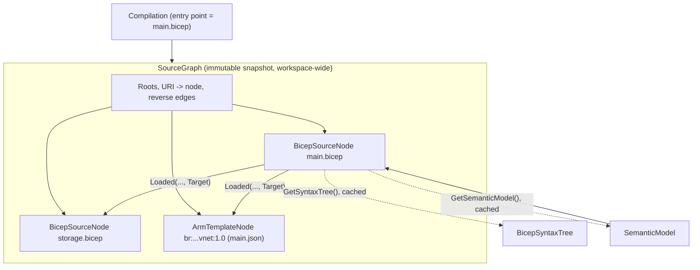
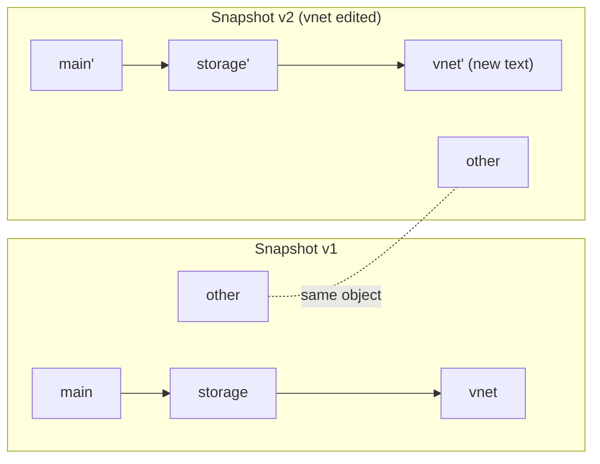
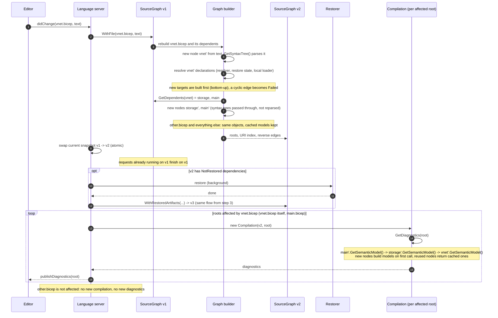

# Source graph redesign

Status: draft, not scheduled. Follows REP 0022 Phase 0.9c (#20575) and is not part of the artifact aliases and redirects effort.

This note records a design discussion so it isn't lost. It describes what's wrong with how the compiler models "what does this file depend on?", the target design (borrowed from Roslyn), the decisions made so far, and a migration path.

---

## 1. Problem

The source graph has no node for "this file, within this build". Facts about one file are spread across global maps, and every consumer reassembles them.

| Symptom | Where |
|---|---|
| A file's declared dependencies live in a global map keyed by syntax (`SourceFileGrouping.ArtifactLookup`), so consumers filter it by file. This is why every `ArtifactDependency` carries `ReferencingFile`. | `UseRecentModuleVersionsRule`, `ModuleReferenceEnumeration`, `SourceArchive` |
| Implicit extensions (from `bicepconfig.json`) live in a second structure keyed by file (`ImplicitExtensions`). `ArtifactDependency.Syntax` is nullable only to fit them in, and restore and `Rebuild` loop over both structures. | `SourceFileGrouping`, `SourceFileGroupingBuilder` |
| The built-in decision is made in three places: the builder (`extensionEntry.BuiltIn`), `NamespaceProvider` ("no dependency means built-in"), and `NamespaceProvider` again, which fabricates `new ImplicitExtension("sys", null)`. | `SourceFileGroupingBuilder`, `NamespaceProvider` |
| `IArtifactFileLookup` mixes a module-to-file query (`TryGetSourceFile`), the global dependency map and the implicit extensions. Its only implementation is `SourceFileGrouping`. | `IArtifactFileLookup.cs` |
| A file that can't be read is recorded in `SourceFileLookup` (`IOUri -> ResultWithDiagnosticBuilder<ISourceFile>`) while its dependency says `Loaded`, so "the module's file is missing" isn't a dependency state. | `LocalArtifactLoader.TryOpen`, `SourceFileGroupingBuilder` |
| `BicepSourceFile`, a shared parse object, holds `referencedAuxiliaryFileUris`, a mutable bag appended to during semantic analysis. | `BicepSourceFile.cs` |
| The language server reuses semantic models across compilations by hand: `BicepCompilationManager` builds a `modelLookup` (`ISourceFile -> ISemanticModel`) and copies over models of files that don't depend on the changed file. Because the key is object identity, it forces a recompilation with `EntryPoint.ShallowClone()` "so it counts as a different file even though all the content is identical". | `BicepCompilationManager` |
| Some per-file analysis depends on the entry point: `NoConflictingVersionConstraintsRule` and `NoIncompatibleEntrypointVersionRule` only run when `model.SourceFile == model.SourceFileGrouping.EntryPoint`. A reused model keeps the grouping of the compilation that created it. | Linter rules |

### Bug found along the way

For an implicit extension with no `extensions` entry, the builder used to store the configuration's error while `NamespaceProvider` reported BCP397 from its own `Config is null` check, so the stored error was never read. Verified with the CLI:

| `implicitExtensions` | Reported | Stored and never shown |
|---|---|---|
| `["notConfigured"]` | BCP397 | BCP204 "Extension is not recognized" |
| `["microsoftGraph"]` | BCP397 | `MicrosoftGraphBuiltinRetired`, with its migration code fix |

0.9c makes the builder store BCP397 itself, so nothing is computed only to be dropped. An explicit `extension microsoftGraph` still reports the retired message, so the two paths disagree (section 7).

---

## 2. How Roslyn models this

Three layers, each immutable, each rebuilt only when its own inputs change.

| Layer | Types | Depends on | Shared across |
|---|---|---|---|
| Syntax | `SourceText`, `SyntaxTree` (red/green trees) | One file's text | Every compilation and snapshot |
| Semantics | `Compilation`, `SemanticModel` (compilation, tree) | Trees, references, options | One snapshot |
| Workspace | `Solution` -> `Project` -> `Document` (`DocumentId`) | Everything; carries identity | One snapshot |

- A `SyntaxTree` never refers to a compilation, so one tree object sits in any number of compilations.
- A `Document` owns its text and lazily parsed tree, and reaches the semantic model through its snapshot. `Document.GetSemanticModelAsync()` is roughly `document.Project.GetCompilationAsync()` then `compilation.GetSemanticModel(tree)`.
- `solution.WithDocumentText(id, text)` creates a new snapshot; unchanged documents keep their trees, unaffected projects keep their compilations.
- Roslyn splits `DocumentState` (shared across snapshots) from `Document` (state + `Solution` back-reference), because a document's semantics depend on its whole project and solution.

### Mapping to Bicep

C# files in a project share one declaration space; Bicep files don't. Each Bicep file has its own scope and semantic model, and every cross-file link is an explicit, one-way reference. So a Bicep file plays the role of a whole Roslyn project.

| Roslyn | Bicep |
|---|---|
| `Solution` | The language server's workspace |
| Project-reference graph | `SourceFileGrouping` today; `SourceGraph` in this design |
| `Project` + its `Compilation` | One Bicep file and its `SemanticModel` |
| `ProjectReference` | A local `module` / `import` / `using` / `extends` of a `.bicep` file |
| Metadata reference (compiled DLL) | A local ARM template `.json` module |
| `PackageReference` + NuGet restore | A registry module (`br:`, `ts:`) + restore into `~/.bicep` |
| Unresolved package reference | `ArtifactDependency.NotRestored` |
| Source Link | `source.tgz` (`Bicep.Core.SourceLink`) |
| `Document` | Missing today: `SourceNode` in this design |

One difference shapes the design: Roslyn knows a solution's structure from project files without parsing anything, so it parses on demand. Bicep discovers its graph from syntax (the `module`, `import`, `using` and `extends` declarations), so every file in the closure is parsed while the graph is built.

---

## 3. Target design

### Overview

- **`SourceGraph`** is one immutable snapshot for the whole workspace (one per CLI build, one current snapshot in the language server). It holds the roots, an index from URI to node, and the reverse edges.
- **`SourceNode`** is one file in the snapshot. Nodes are immutable, point directly to the nodes they depend on, and never point back to the graph, so any number of snapshots can share a node.
- **`Compilation`** is a thin view of a snapshot from one entry point: emit, and diagnostics as seen from that entry point (including the entry-point-only rules).
- **`BicepSyntaxTree`** is what the parser produces for a `.bicep` or `.bicepparam` file. JSON files have no syntax tree; their semantic models parse the JSON.



### Nodes

```csharp
public abstract class SourceNode
{
    public IFileHandle FileHandle { get; }               // identity
    public string Text { get; }                          // from the editor buffer or from disk

    // Captured when the node is built (replacing BicepSourceFile.LoadConfiguration/LoadFeatures, which
    // query the configuration manager on every call). The graph builder needs them to resolve dependencies,
    // so they can't belong to the semantic model; WithConfiguration recreates the affected nodes.
    public IBicepConfiguration Configuration { get; }
    public IFeatureProvider Features { get; }
    public IOUri Uri => this.FileHandle.Uri;

    public abstract ISemanticModel GetSemanticModel();   // computed on first call, cached on the node
}

// .bicep and .bicepparam
public sealed class BicepSourceNode : SourceNode
{
    public BicepSyntaxTree GetSyntaxTree();              // parse of Text, cached on the node

    // Declared dependencies in declaration order, then implicit extensions in configuration order.
    public ImmutableArray<ArtifactDependency> Dependencies { get; }

    public ArtifactDependency? TryGetDependency(IArtifactReferenceSyntax declaration);
    public ArtifactDependency? TryGetImplicitExtension(string name);

    public override SemanticModel GetSemanticModel();
}

public sealed class ArmTemplateNode : SourceNode
{
    public override ArmTemplateSemanticModel GetSemanticModel();   // owns Template, TemplateObject
}

public sealed class TemplateSpecNode : SourceNode
{
    public override TemplateSpecSemanticModel GetSemanticModel();
}

// Only what the parser produced: no file handle, no services.
public sealed class BicepSyntaxTree
{
    public BicepSourceFileKind Kind { get; }
    public ProgramSyntax Root { get; }
    public ImmutableArray<int> LineStarts { get; }
    public IDiagnosticLookup LexingErrors { get; }
    public IDiagnosticLookup ParsingErrors { get; }
    public ISyntaxHierarchy Hierarchy { get; }
    public DisabledDiagnosticsCache DisabledDiagnostics { get; }
}
```

- **Properties** are the node's input (`FileHandle`, `Text`) and graph data set by the builder (`Dependencies`). **Methods** are derived from the node and cached on it (`GetSyntaxTree()`, `GetSemanticModel()`).
- The builder calls `GetSyntaxTree()` immediately to find dependencies, so parsing still happens while the graph is built; the method only makes the cache explicit.
- `GetSemanticModel()` is a method because the first call can bind the file, load extension types and build its dependencies' models.
- Covariant overrides narrow `GetSemanticModel()` per node type, so a `BicepSourceNode` caller gets a `SemanticModel` without casting.

### Dependencies

```csharp
// Why the file has this dependency.
public abstract record DependencyOrigin
{
    public sealed record Declaration(IArtifactReferenceSyntax Syntax) : DependencyOrigin;   // module, import, using, extends, extension, test
    public sealed record ImplicitExtension(string Name) : DependencyOrigin;                 // "implicitExtensions" in bicepconfig.json
}

public abstract record ArtifactDependency(DependencyOrigin Origin)
{
    // Target is the node of a loaded module; null for extensions.
    public sealed record Loaded(DependencyOrigin Origin, Artifact Artifact, SourceNode? Target) : ArtifactDependency(Origin);
    public sealed record NotRestored(DependencyOrigin Origin, RemoteArtifactReference Reference) : ArtifactDependency(Origin);
    // Reference is null when the text didn't resolve.
    public sealed record Failed(DependencyOrigin Origin, ArtifactReference? Reference, DiagnosticBuilderDelegate Error) : ArtifactDependency(Origin);
}
```

- `ReferencingFile` is gone: the owning node is the file.
- The origin replaces `Syntax?` (where `null` meant implicit) with two explicit cases. It isn't a duplicated key: the lookup indexes are private to the node and built from it.
- The two lookups stay separate. Every caller knows which kind it has, and the keys differ in kind: a place in source (compared by reference) and a configured name (compared case-insensitively with `LanguageConstants.IdentifierComparer`). Unifying them behind `TryGetDependency(DependencyOrigin)` would need a custom comparer and help no caller.
- Built-in implicit extensions aren't dependencies; `NamespaceProvider` reads their names from configuration. `ImplicitExtension` and the fabricated `sys` entry go away.
- A target that can't be read (missing local file) is a `Failed` dependency, not a node. The builder reads the target before choosing the state.

### Configuration

Each node captures `Configuration` and `Features` when it's built, so one compilation sees one configuration even if it changes partway through (today a purge in the middle of a compile can give one compilation two). Two inputs decide which configuration that is:

- **The explicit configuration file, if any.** The CLI `--config` option and the JSON-RPC `configPath` field replace `bicepconfig.json` discovery for every file in the build. It becomes a graph-build input (`BuildAsync(roots, explicitConfigUri)`), and every node in that graph captures it. This replaces `ExplicitConfigurationContext`, which carries the path as ambient `AsyncLocal` state, so work done after the scope ends silently falls back to discovery (configuration plan PR 11, handed off here). The language server never sets it.
- **Otherwise, discovery** through `IBicepConfigurationManager`, as today.

The services the builder calls to resolve a dependency (`ArtifactReferenceResolver`, `RemoteArtifactContextFactory`, `ModuleAliasMockRule`, `FeatureProviderFactory`) take the referencing node's configuration instead of looking it up by URI, so the explicit configuration reaches them without ambient state.

The configuration manager keeps its caches current by itself (configuration plan PR 13): each cached chain records the files it read and their versions. When an `IFileChangeNotifier` reports changed files, it drops the chains those changes made stale and raises `ConfigurationChanged`, which `WithConfiguration` consumes:

| `ConfigurationChangedEventArgs` | Meaning | Nodes to recreate |
|---|---|---|
| `ConfigFileUris` | Leaf configuration files whose chains were dropped (the leaf, or a file it `extends`, changed) | Nodes whose configuration came from one of them |
| `DirectoryUris` | Folders where a `bicepconfig.json` was created or deleted at or above them, so discovery must run again | Nodes whose file is in one of them; they may now use a different configuration |

Hosts without a file watcher (`bicep jsonrpc`, the MCP server) report that any file may have changed at the start of each request, and the manager checks each cached chain once on its next read; one-shot CLI commands report nothing. With configuration captured per node, that's one check per node per graph build.

### Snapshot and compilation

```csharp
public sealed class SourceGraph
{
    public ImmutableArray<BicepSourceNode> Roots { get; }            // entry points are always .bicep / .bicepparam
    public BicepSourceNode GetRoot(IOUri uri);                       // asking for a non-root is a programming error
    public SourceNode? TryGetNode(IOUri uri);                        // any node; may not exist
    public IEnumerable<SourceNode> GetDependents(SourceNode node);   // reverse edges

    public SourceGraph WithFile(IOUri uri, string text);
    public SourceGraph WithConfiguration(ConfigurationChangedEventArgs change);
    public SourceGraph WithRestoredArtifacts(IEnumerable<RemoteArtifactReference> restored);
    public SourceGraph WithRoots(IEnumerable<IOUri> roots);          // documents opened or closed
}

public sealed record FileDiagnostics(BicepSourceNode Node, ImmutableArray<IDiagnostic> Diagnostics);

public sealed class Compilation(SourceGraph graph, BicepSourceNode entryPoint)
{
    public SourceGraph Graph { get; } = graph;
    public BicepSourceNode EntryPoint { get; } = entryPoint;

    public IEnumerable<SourceNode> GetClosure();                     // the entry point and what it reaches

    // True if any file in the closure has an error. Checking the entry point is enough (see section 4).
    public bool HasErrors();
    // Every Bicep file in the closure, entry point first, then in dependency order: emit gating, CLI and
    // JSON-RPC builds, language server build commands. Replaces GetAllDiagnosticsByBicepFile(), whose
    // dictionary no caller used for lookups and which enumerated in hash order. JSON files have no entries:
    // their problems are reported on the Bicep declaration that references them.
    public ImmutableArray<FileDiagnostics> GetDiagnostics();

    // One file, as seen from this compilation: its model diagnostics, plus the entry-point-only
    // rules when the node is the entry point. Replaces GetSourceFileDiagnostics(...).
    public ImmutableArray<IDiagnostic> GetDiagnostics(SourceNode node);
    public EmitResult Emit(Stream output);
}
```

| Today's `Compilation` member | After |
|---|---|
| `SourceFileGrouping` | `Graph` + `EntryPoint` |
| Model cache (`Lazy<ISemanticModel>` by URI) | On each node |
| Services (namespace provider, environment, linter, factory) | With the graph builder; nodes receive what their models need |
| `GetEntrypointSemanticModel()`, emit, `HasErrors()` | Stays |
| `GetAllDiagnosticsByBicepFile()`, `GetSourceFileDiagnostics(...)` | `GetDiagnostics()` (closure, ordered list of `FileDiagnostics`) and `GetDiagnostics(node)` |
| Entry-point-only linter rules | Move here from per-file models; their diagnostics are part of `GetDiagnostics(EntryPoint)` |

`Compilation` keeps its name: it compiles one entry point into one output, like Roslyn's `Compilation`, and the name appears on about 1,280 lines.

### Usage

```csharp
// CLI: one root, one compilation. explicitConfigUri is the --config file, or null to discover bicepconfig.json.
var graph = await graphBuilder.BuildAsync(roots: [entryUri], explicitConfigUri);   // resolve, restore, re-resolve
var compilation = new Compilation(graph, graph.GetRoot(entryUri));
compilation.Emit(stream);

// Language server: one current snapshot for every open document, replaced atomically.
void OnDidChange(IOUri uri, string text)
{
    var next = this.snapshot.WithFile(uri, text);
    Interlocked.Exchange(ref this.snapshot, next);

    foreach (var root in next.Roots.Where(root => next.IsAffectedBy(root, uri)))
    {
        Publish(root.Uri, new Compilation(next, root).GetDiagnostics(root));
    }
}

// Any handler: the Document.GetSemanticModelAsync() experience. Pattern-match instead of casting.
if (snapshot.TryGetNode(uri) is BicepSourceNode node)
{
    var model = node.GetSemanticModel();
}

// Linter: this file's module declarations in declaration order; no global scan, no file filter.
foreach (var dependency in model.Node.Dependencies)
{
    if (dependency.Origin is DependencyOrigin.Declaration { Syntax: ModuleDeclarationSyntax } &&
        dependency.Reference is IOciArtifactReference oci) { /* ... */ }
}

// Hover / go to definition on a declaration.
var reference = node.TryGetDependency(moduleSyntax)?.Reference;

// Restore: one collection covers declared and implicit dependencies.
var toRestore = graph.Nodes.OfType<BicepSourceNode>()
    .SelectMany(node => node.Dependencies)
    .OfType<ArtifactDependency.NotRestored>()
    .Select(x => x.Reference);
```

### Reuse across snapshots (path copying)

A node points to the nodes it depends on, never to the graph. When a file changes, the new snapshot replaces that node and every node that depends on it, and reuses every other node with its cached syntax tree and semantic model. Recreated dependents pass their unchanged syntax tree through; nothing is reparsed.



| Change | Reparsed | New nodes | Semantic models rebuilt |
|---|---|---|---|
| Edit a leaf module | That file | It and its dependents | It and its dependents |
| Restore finishes | Nothing | Nodes with matching `NotRestored` dependencies, and their dependents | Same |
| `bicepconfig.json` (or a file it `extends`) edited | Nothing | Nodes using that configuration, and their dependents | Same |
| `bicepconfig.json` created or deleted | Nothing | Nodes in folders at or below it, and their dependents | Same |
| Same module in two open entry points | Once | One node, shared | One model, shared |

The objects recreated are exactly those whose models are invalid. This replaces the language server's hand-written `modelLookup` and `ShallowClone()`.

### Language server

LSP doesn't constrain how a server models state: it sends text (`didOpen`, `didChange`, `didClose`) and receives diagnostics per URI. Roslyn's server keeps one `Solution` snapshot for the whole workspace; Bicep would do the same.

- One current `SourceGraph`, replaced atomically on every notification. Handlers take the current snapshot and use it without locks.
- Open documents are the roots. When a document closes, nodes nothing reaches are dropped.
- Each open document is an entry point. Its diagnostics come from its own `Compilation`.
- The workspace stores each open document's text and version; parsing happens in the node.

#### A file change, end to end

The user edits `vnet.bicep` (open in the editor), which `storage.bicep` references, which `main.bicep` (also open) references. `other.bicep` is open too and doesn't depend on `vnet.bicep`.



1. Only the changed file is reparsed. Its dependents are recreated because they point to it, but they keep their syntax trees.
2. The new snapshot is published atomically; the previous one stays valid for requests already in flight.
3. Restore runs in the background and produces another snapshot through the same flow.
4. Semantic models are built lazily, from the entry point down. New nodes (the changed file and its dependents) build models; every other node returns its cached one.

---

## 4. Decisions

- **Workspace-wide snapshot (R1).** A file's dependencies depend on its text, configuration and restore state, not on which entry point reached it, so one snapshot serves every entry point. The two entry-point-only linter rules move to `Compilation`, making per-file models independent of the entry point.
- **No node state class, no `Graph` back-reference on nodes.** Bicep semantics depend only on a file's text, configuration and explicit references, so a node can point to its dependency nodes instead of to the graph. Immutable nodes are then shareable across snapshots by construction.
- **Nodes are built bottom-up.** Targets are created before the files that reference them. A cyclic edge can't be built, so it becomes a `Failed` dependency (BCP094/BCP095), detected while walking.
- **Semantic models are cached per node** (`Lazy`). Building a model can request its dependencies' models, which is safe because the dependency graph has no cycles and a model excludes its own file from lookups (`ISemanticModelLookup.Excluding`). Per-node caches make "no cycles" load-bearing.
- **Polymorphic nodes.** Only Bicep and Bicep parameter files have syntax trees and dependencies; ARM templates and Template Specs are leaves with their own semantic models.
- **JSON is parsed inside its semantic model.** Direct uses of `ArmTemplateFile` / `TemplateSpecFile` outside models are few (the definition handler, `SourceArchive`, completion, `IArtifactReferenceSyntaxExtensions`) and move to the node type or the model.
- **`ISourceFile` family retires.** The node replaces "a file in the graph"; the parse layer becomes `BicepSyntaxTree`. "Syntax tree" fits because the parse type becomes Bicep-only and holds only parser output.
- **No `SourceText` type.** Bicep has no incremental parsing; the node holds the text and caches the parse.
- **Names:** `SourceGraph`, `SourceNode` (`BicepSourceNode`, `ArmTemplateNode`, `TemplateSpecNode`), `BicepSyntaxTree`, `ArtifactDependency`, `DependencyOrigin`. Keep `Compilation`.
- **Keep the name `ArtifactDependency`.** Not every target is source (extensions, compiled registry modules, Template Specs), and next to `SourceNode`, `SourceDependency` would read as "a dependency of a source node".
- **Loading isn't duplicated.** Each declaration opens its target once; parsing is deduplicated by URI and restore by reference. If opening ever matters (a local extension `.tgz` is hashed per declaration), add a per-build `ArtifactReference -> Artifact` cache. Dependencies are edges; artifacts and nodes are what they point to.
- **`Compilation.HasErrors()` means "any error in the closure", and checking the entry point is enough.** Errors cascade up every edge: a referenced file with errors puts BCP104 (`ReferencedModuleHasErrors`) or BCP188 (`ReferencedArmTemplateHasErrors`) on the `module`, `test`, `import` and `using` declaration that references it, and an `extends`ed parameters file's errors are re-reported in the extending file (verified with the CLI). So the entry point's model has an error whenever any file in its closure does. `CompilerVersionCheckTests` pins the BCP104 cascade. `CliJsonRpcServer` and `DiagnosticLogger`, which flatten every file's diagnostics to answer the same question, can call `HasErrors()` instead.
- **Referenced auxiliary files belong to the semantic model.** `load*()` calls are found while type checking, which is why `BicepSourceFile.referencedAuxiliaryFileUris` is a mutable bag filled during analysis, and why the MCP server's `get_file_references` calls `GetAllDiagnosticsByBicepFile()` only to force that analysis before reading the bag. The model exposes `GetReferencedAuxiliaryFiles()`, which runs the type checking it needs, so the result is complete whenever it's read. Consumers walk the closure:

  ```csharp
  // MCP get_file_references, and the language server's auxiliary-file watching.
  foreach (var node in compilation.GetClosure().OfType<BicepSourceNode>())
  {
      fileUris.Add(node.Uri);
      fileUris.UnionWith(node.GetSemanticModel().GetReferencedAuxiliaryFiles());
      if (node.Configuration.ConfigFileUri is { } configUri) { fileUris.Add(configUri); }
  }
  ```

## 5. Update operations (R3)

- `WithFile(uri, text)`: a new node for `uri` (reparsed, dependencies re-resolved); dependents recreated with their trees passed through.
- `WithRestoredArtifacts(references)`: nodes with matching `NotRestored` dependencies re-resolved; dependents recreated.
- `WithConfiguration(change)`: nodes using a dropped configuration (`ConfigFileUris`) or in a folder where discovery must run again (`DirectoryUris`) are rebuilt with their new configuration and re-resolved; dependents recreated. The language server calls it from `IBicepConfigurationManager.ConfigurationChanged` (section 3, Configuration).
- `WithRoots(roots)`: nodes added for newly opened documents; unreachable nodes dropped.

## 6. Migration (R4)

Each step leaves a working build.

1. **Read-only node view.** Add `SourceNode` built from today's `ArtifactLookup` (grouped by `ReferencingFile`) plus `ImplicitExtensions`, and move consumers to it. The builder doesn't change.
2. **The builder produces nodes.** `ReferencingFile` and `Syntax` leave `ArtifactDependency`; `DependencyOrigin` arrives. `IArtifactFileLookup` is replaced by node access. Nodes capture their configuration when they're built; the builder takes the explicit configuration file as an input and passes each node's configuration to the services it calls, and `ExplicitConfigurationContext` is deleted.
3. **Unreadable targets become `Failed`.** `SourceFileLookup` maps URIs to nodes.
4. **Built-in implicit extensions leave the graph.** `ImplicitExtension` is deleted.
5. **Nodes own their models.** `node.GetSemanticModel()`; `SemanticModel` reaches dependencies through nodes instead of `SourceFileGrouping` and `ModelLookup`; `referencedAuxiliaryFileUris` moves from `BicepSourceFile` to `SemanticModel.GetReferencedAuxiliaryFiles()`; `Compilation` thins out and takes the entry-point-only rules.
6. **Workspace-wide snapshot in the language server.** One `SourceGraph` with the update operations; `modelLookup` and `ShallowClone()` retire. `ConfigurationChanged` calls `WithConfiguration` instead of `BicepCompilationManager.RefreshAllActiveCompilations`.
7. **Split the parse layer.** `BicepSourceFile` becomes `BicepSyntaxTree` plus node members; JSON parsing moves into the JSON semantic models; the `ISourceFile` family retires. Mechanical but wide (`BicepFile` alone is on about 660 lines).

## 7. Open questions

- Which error does an unconfigured implicit `microsoftGraph` report: BCP397, or the retired message with its code fix, as the explicit declaration does?
- Does namespace order (declared, implicit, built-in) affect diagnostics or the emitted `imports`? The node's ordered `Dependencies` should preserve it.
- REP 0022 PR 6 sends data-file loads through the resolver. If those become graph edges, they need their own edge type (for example `AuxiliaryFileDependency`); they aren't artifacts, and their freshness is the graph's. Otherwise `AuxiliaryFileCache` keeps itself current the way the configuration manager does (configuration plan PR 14).
- How services reach nodes and models without a graph back-reference: passed when the builder creates the node, or held by a small shared context object.
- How diagnostics for restore failures are reported per node (today `BicepCompiler` uses `ReferencingFile` and `Syntax`; after step 2, the node plus `DependencyOrigin`).

## 8. Already done (REP 0022 Phase 0.9c, #20575)

- The compiler gets an `Artifact` (`ModuleArtifact`, `ExtensionArtifact`) instead of a file; `ArtifactCacheEntry.EntryPoint` and `TryLoadSourceArchive` removed.
- `ArtifactResolutionInfo` replaced by `ArtifactDependency` (`Loaded` / `NotRestored` / `Failed`), removing `RequiresRestore` and the duplicate `Reference`. The states carry over to this design unchanged.
- `ImplicitExtension.Config` removed: an implicit extension without an `extensions` entry is a `Failed` dependency carrying BCP397. `ExtensionRegistryTests` pins it.
