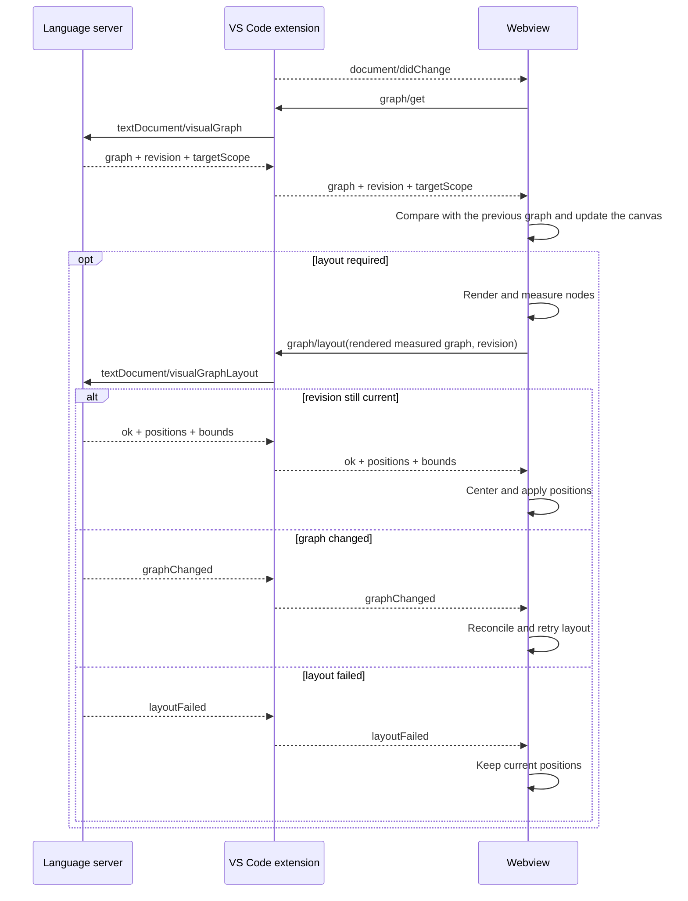
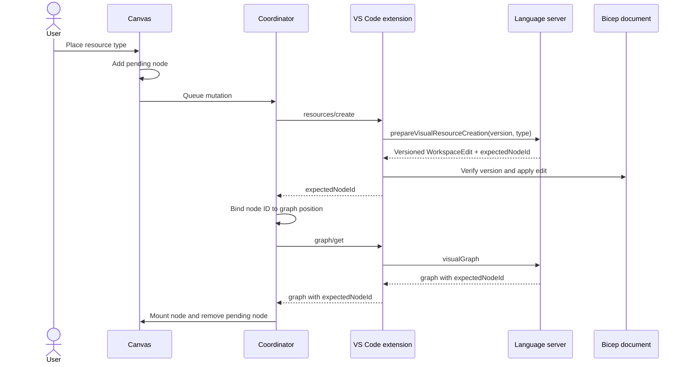

# Visual Designer Architecture

The visual designer is a React webview backed by the current Bicep compilation. The language server
owns graph construction and source generation; the webview owns rendering, measured layout, and user
interaction.

## Participants

| Participant       | Responsibility                                                                                    |
| ----------------- | ------------------------------------------------------------------------------------------------- |
| Language server   | Build the authoritative graph, compute layout, validate resource types, and generate Bicep syntax |
| VS Code extension | Bind requests to a document, forward LSP messages, apply edits, and publish settings              |
| Webview           | Maintain a client graph, render and measure nodes, coordinate updates, and provide interaction    |

The webview message contracts are defined by feature:

- [Core API](../src/core/api.ts): settings, graph, layout, source navigation, module restore, resource creation, and undo
- [Palette API](../src/features/palette/api.ts): resource type catalog and API versions

## Graph synchronization

Graph reconciliation and layout are separate phases because layout uses dimensions measured after
React renders the nodes.



### Graph contract

`graph/get` returns the whole graph (`nodes`, `edges`) built from the live compilation, the document's
`targetScope: "resourceGroup" | "subscription" | "managementGroup" | "tenant" | null`, and the
document's `errorCount`, which includes errors that belong to no node, and the graph's topology
`revision` (see [Layout contract](#layout-contract)). The graph
is null when no compiled model is available, and the webview then keeps what it shows. A whole graph
rather than a delta means no response depends on what the webview showed before, so the host keeps no
state and responses need no ordering. The webview compares each graph with the previous one to decide
what to mount and whether layout is stale. Only accepted coordinator updates publish scope to canvas
state; superseded responses and responses overlapping mutations cannot overwrite it. Scope-only
changes do not invalidate graph layout or adjust zoom.

The webview also holds a session-local set of collapsed module IDs: the user's choice, kept through
graph refreshes even while a module is missing or empty, so a module that comes back is still
collapsed. It projects the authoritative graph before rendering: descendants of a collapsed module
that has children are omitted, dependencies wholly inside it are omitted, and dependencies crossing
its boundary terminate at the collapsed module. The source graph is unchanged.

The passive scope indicator is outside the export canvas subtree, like the palette and controls.
It uses Azure resource-group, subscription-alias, and management-group icons; tenant uses the neutral
organization Codicon. It stays visible when resource creation is disabled.

### Remote modules

The language server expands a module whose Bicep source it can read:

- A local module expands into the declarations of its file in the compilation.
- A registry (`br:`) module expands into the source it was published with, read from the local module
  cache once the module dispatcher reports it restored. Each published file is compiled on its own,
  as Go to Definition does for imported symbols, and cached by its text. Its module paths do not
  resolve on their own, so the source archive's links (the same ones the editor follows in a
  `bicep-extsrc:` document) say which published file or registry module each one names. Registry
  modules named in published source are resolved with the user's configuration. Published source is
  not the user's to fix, so its nodes never report errors.
- Any other remote module is a leaf whose `sourceStatus` says why it shows no children:

  | `sourceStatus` | Meaning                                                              | Module toggle                   |
  | -------------- | -------------------------------------------------------------------- | ------------------------------- |
  | `unrestored`   | A registry module not in the cache yet                               | Expand: restores, then opens    |
  | `error`        | Its restore failed, or its archive cannot be read; see `sourceError` | Error color; expand tries again |
  | `unavailable`  | Published without source, or a template spec                         | Disabled; tooltip says why      |

  `sourceError` holds the registry's or the archive's message. A registry module that contains itself
  through a republished tag is shown once more as a module with no children and no status.

Both fields are metadata, not topology, and the webview owns their wording. Building the graph never
restores anything, and nothing in the designer restores a module in the background. Expanding an
`unrestored` or `error` module sends `module/restore`, and the language server restores that one module
(`textDocument/visualGraphRestoreModule`), as resolving a link in published source does in the editor. A
retry after an error forces the restore, so it does not report the failure the module dispatcher
remembers; a forced restore now clears that memory. The restore does not recompile the document, whose
compilation does not depend on the module. When it settles the webview fetches the graph, and opens the
module if its children arrived; otherwise the toggle shows the new status. Until the module has opened
(its children laid out) or shows its new status, its toggle shows a progress ring and is disabled; the
restoring modules are core view state, so a restore already running is not started again.

Children can also arrive without the user asking: the language server restores the registry modules a
document references when it compiles it. Whenever a remote module that showed no children gains some,
the webview adds it to the collapsed set before showing the graph. Its node keeps its size, so nothing
is laid out and nothing moves; the user opens it when they want to see inside.

### Layout contract

`graph/layout` submits a `MeasuredGraph`, the graph the webview renders: node identity and containment,
measured node dimensions, and edges. It may omit nodes the webview hides, such as the children of a
collapsed module. Positions are not sent to the server. The request also carries the `revision` that
`graph/get` returned with the graph it was rendered from: a hash of the graph's topology (node IDs,
kinds, and parents, and edge IDs and endpoints) that ignores metadata such as errors. The language
server rebuilds the live graph and answers `graphChanged` when its revision differs; otherwise it lays
out the measured graph exactly as sent. It knows nothing about collapsed modules. An `ok` response
carries the positions of the nodes the engine laid out and the bounds of the measured graph. A
measured graph that is not well formed (a duplicate ID, or a parent or edge endpoint that is not in
the graph) yields `layoutFailed`.

The response status controls the next step:

| Status         | Client action                                 |
| -------------- | --------------------------------------------- |
| `ok`           | Apply node positions and fit the graph bounds |
| `graphChanged` | Reconcile and retry the same layout mode      |
| `layoutFailed` | Reveal the graph at its current positions     |

Source locations are resolved on demand through `document/revealNode` and are not stored in graph
metadata. The language server answers with the declaring document's URI: a file, or a read-only
`bicep-extsrc:` view of a registry module's published source.

### Layout invalidation

Layout may be stale when, compared with the previous graph:

- A node or edge was added or removed
- A node changed kind or container
- A node's `type` or `isCollection` changed, or it started or stopped being drawn around its children

An atomic module is the same size whether or not it has children, so children arriving while
it is collapsed, or `sourceStatus` and `sourceError` changing, do not invalidate layout.

A correlated resource node with an explicit placement does not invalidate layout by itself.
Undo of an independent top-level resource creation likewise removes only that node;
surviving positions and the camera stay put, even if the graph update arrives late. An edge
change or another layout-affecting change still requests layout. Changes limited to `hasError` or
the error count do not invalidate layout.

After an invalidating change, the webview renders and measures the graph. It requests layout only when
topology or dimensions differ from the last successful layout input.

- Automatic layout may skip unchanged input and fits the viewport after success.
- **Reset Graph Layout** bypasses the unchanged-input check and preserves the viewport.
- A **subgraph** layout places only pending subgraphs, such as the children of a module that just
  opened (see below), and leaves every other node and the camera where they are. A pending automatic
  layout or reset replaces it, since either places those subgraphs too.

Collapsing a module does not run layout. The collapsed module is centered where its frame was, and the
graph morphs the module's node from the frame's box to its collapsed size while its descendants and their
edges fade out. Expanding reverses this: the frame grows from the collapsed module around the descendants,
which fade in, and the module comes to the front (see the paint order below). The node and its element are
kept throughout, so the content animates its own header in
step. Hidden descendants keep their positions in the one positions map, and they move with the module
however it moves (a drag, a layout, or undo), so they are in place when the module opens. Children that
were never shown, because they arrived while the module was collapsed or the module was just restored,
are laid out before the module opens: they render hidden and unplaced, so they are measured, while the
module stays drawn as it was (`lib/graph` draws a node as a container only once one of its children has a
position). A subgraph layout then places them: the webview sends the language server the module and its
descendants alone, as a graph of their own with the same revision, and centers the resulting box where
the module was. The module then opens around them with the same single morph and fade as any other
module. If that layout fails they are placed at the module's center rather than left hidden. The opened
module may overlap its neighbors until the user runs Reset Layout.
The camera and unrelated nodes stay fixed. Under reduced motion the frame snaps and nothing fades.
Collapsing or expanding is an undo step that replays as the toggle does, so a step is always undone in the
collapse state it was recorded in. Like a drag, the toggle is ignored while a source edit or Reset Layout is
in flight.

### Positions and drawing

Core owns one map of node **centers**, including those of nodes hidden in a collapsed module.
Containers have none: they enclose their children. Layout, drags, and undo write the map, each saying
whether nodes animate there or move at once; the server's top-left layout positions are converted to
centers with the measured sizes. `lib/graph` derives each node's target box from its center and the
size it measured, and owns where each node is drawn: a node springs toward its target, a container
encloses where its children are drawn, and a node that becomes a container or stops being one morphs
from the box it was drawn at. Only the drawn boxes move during an animation, so the positions core
saves, sends, and records are always where nodes are going. Layout waits until every shown node
has measured itself, so the centers it computes use real sizes.

Nodes and edges are stacked as nested elements would be: a parent, then the edges between its
children, then each child with its descendants. Edges are therefore below every node in their parent
and above the parent's frame; top-level edges are below every node. Bicep edges always join siblings.
Among siblings, raised nodes are painted above the others, along with each of their ancestors, and stacked
as windows are: the most recently raised on top. Focusing, dragging, or opening a node raises it; dragging
raises a node without focusing it, and opening a module brings it in front of the neighbors it grows over.

The one exception is a node that sits on a sibling module: their target boxes overlap, and the node
is drawn above the module, because it was raised more recently, or neither was raised and it is atomic
or later in sibling order. Its edges should cross the module rather than vanish under it, yet stay
below the nodes they join. All nodes share one stacking context, so the edges of the nodes sitting on
a module are painted just above it, with those nodes and the siblings joined to them by an edge lifted
above it. Every other sibling stays where it was drawn: one that the module covers stays below it, as
does anything drawn below that sibling where they overlap. The paint order reads target boxes and
edges, so it follows a node as it is dragged on and off a module. An edge of a node sitting on one
module is drawn above every module that something sits on in that parent, and above the siblings
those modules cover, the compromises of a single stacking context.

Later stages extend these boundaries rather than move them:

- Remote modules (stage 3) were more containers from the server, with no change to `lib/graph`. They
  added the `subgraph` layout, which places a module's new children around it; keeping placed
  nodes fixed in a whole-graph layout is still open. Resource containers (stage 4) can follow suit;
  which containers can collapse is a predicate in `projectGraph`.
- Selection (stage 5) is view state beside focus. The canvas raises it through `Graph`, and dragging a
  selection moves several nodes through the same position rules.
- Rename (stage 6) remaps IDs in the view state, the positions map, and the undo history.
- Placeholders (stage 7) stay outside the graph; a committed drop becomes a position. A module dropped
  collapsed is added to the collapsed set before its node arrives. Keeping placed nodes fixed while
  others are laid out is a layout request option, not a client concern.

### Undo history

A node drag records the positions at the first actual movement and commits one history step at the end
of the gesture: the nodes whose positions changed, including the hidden descendants of a dragged
collapsed module. Dragging a module moves everything inside it in one step. Collapsing or expanding a
module is one step. A successful Reset Layout
records one step from the positions to the server's layout; a failed or unchanged layout adds none.
Positions are where nodes are going, so a reset or drag that interrupts an animation records its target. **Undo** and **Redo** are buttons in their own panel below the control bar;
the focused designer also accepts Ctrl/Cmd+Z, Ctrl/Cmd+Shift+Z, and Ctrl+Y (Windows/Linux). Both
traverse one session-local timeline of layout steps **and** designer-created resource
declarations. Layout replay uses the same spring as automatic layout
without requesting server layout, changing the camera, or editing Bicep source. A subsequent
layout action retargets an in-progress animation, and a drag moves the dragged nodes at once. Replay
also restores the positions of nodes hidden in a collapsed module.
Under the effective VS Code or system reduced-motion preference, positions snap to their target.

Pan, zoom, focus, and graph reconciliation are not history steps. Reconciliation keeps layout
history for nodes still in the graph, shown or hidden, and discards entries for removed IDs,
including when a symbolic rename changes an ID. A node removed by _undo of its creation_ keeps its redo
snapshots; other removed nodes cannot inherit stale position history. History is local to the
visualizer session, not persisted in the Bicep file.

The extension tracks a designer resource insertion by operation ID and verifies the document
version, exact inserted text, and before/after content hashes. Designer source undo/redo sends
that ID to the extension; the extension applies a **new**, minimal `WorkspaceEdit` only when the
expected state matches, then reconciles the graph. Direct editor edits or native editor Undo
invalidate designer source replay instead of risking an unrelated source change.

shortcuts invoke undo history directly, never VS Code's focus-dependent Undo command.
Text fields and the source editor retain their native undo behavior. See the
[undo and redo design](./undo-redo.md) for transaction rules and future rename/module support.

### Client implementation

| Module                                                                      | Responsibility                                                         |
| --------------------------------------------------------------------------- | ---------------------------------------------------------------------- |
| [graph-model.ts](../src/core/graph-model.ts)                                | Indexed client graph, collapse projection, measurement, and comparison |
| [graph-layout.ts](../src/core/graph-layout.ts)                              | Layout invalidation, centering, and layout centers                     |
| [node-positions.ts](../src/core/node-positions.ts)                          | The positions map and the pure rules for changing it                   |
| [show-graph.ts](../src/core/show-graph.ts)                                  | Hands the shown graph and node data to `lib/graph`                     |
| [undo-history.ts](../src/core/undo-history.ts)                              | Pure undo/redo stacks of layout and source steps                       |
| [graph-update-coordinator.ts](../src/core/graph-update-coordinator.ts)      | Update/layout ordering, coalescing, and mutation serialization         |
| [GraphActionsProvider.tsx](../src/core/components/GraphActionsProvider.tsx) | Composes the hooks below and provides `useGraphActions`                |
| [use-graph-sync.ts](../src/core/hooks/use-graph-sync.ts)                    | Graph updates, layout, and Reset Layout                                |
| [use-node-drag.ts](../src/core/hooks/use-node-drag.ts)                      | Moving dragged nodes and their drag history                            |
| [use-module-collapse.ts](../src/core/hooks/use-module-collapse.ts)          | Collapse, expand, and restoring a remote module the user expands       |
| [use-resource-creation.ts](../src/core/hooks/use-resource-creation.ts)      | Placeholder, extension insertion, and creation history step            |
| [use-undo-redo.ts](../src/core/hooks/use-undo-redo.ts)                      | Undo/redo of layout and resource-creation steps                        |

The coordinator tracks pending update and layout work independently:

- Reconciliation runs before layout.
- Reset layout takes precedence over automatic layout.
- The host sends `document/didChange` on every change. The webview discards any response in flight at
  once and requests the update after changes pause for 200 ms; repeated requests coalesce.
- Responses superseded by notifications or mutations are discarded before applying graph or scope state.
- `graphChanged` schedules reconciliation and retries the same layout mode.
- Request promises settle after all currently pending work completes.

The language server is stateless between requests. It rebuilds the authoritative graph from the live
compilation and validates measured layout input before computing positions. Building the graph keeps
only a cache of compiled published source, keyed by file text, so it cannot go stale.

## Resource creation

Resource creation is currently enabled by the experimental resource-editing setting:

```json
"bicep.visualizer.experimental.enableResourceEditing": true
```

It creates top-level Azure resources from the Resource Palette. The Bicep source file remains the
only durable source of truth.

### Catalog and placement

- The palette loads the whole catalog in one `resourceTypes/list` request, `{ knownCatalogId? }` →
  `{ catalogId, resourceTypes }`, and groups it by provider namespace itself. After a document change
  it sends the `catalogId` it holds, and the host resends the types (about 2,300) only when the catalog
  changed. Search results put a curated set of common providers first (compute,
  networking, storage, app hosting, containers, secrets, identity and authorization, deployments,
  databases, caching, AI services, monitoring, and messaging), then list other `Microsoft.*`
  namespaces alphabetically, followed by non-Microsoft namespaces alphabetically. The Featured view
  shows only the curated providers, in the same order.
- Search filters the loaded catalog locally, matching the fully qualified type name.
- Browsing offers three views, as a tab list below the search box: **Featured** shows only the
  curated common providers in that order, **Recent** shows a flat list of types dropped onto the
  canvas this session (newest first, at most eight, each labeled with its provider), and **All**
  shows every provider, Microsoft providers first and each alphabetically. Arrow keys, Home, and End
  move between tabs. The view is a palette atom, so it survives closing the palette; each grouped
  view keeps its own expanded groups until the catalog changes. A drop is recorded as recent when
  the canvas accepts it. Recent shows only types the current catalog offers, at the catalog's
  default version and the shared version choice. Search ignores the view and hides the tabs; when
  no featured provider offers types (for example at tenant scope), Featured links to All.
- Catalog responses carry a `catalogId`; stale responses are discarded.
- The host supplies a newest-stable default API version (newest preview when preview-only).
- Focusing or opening a row's version pill requests `resourceTypes/versions` with
  `{ fullyQualifiedType }`, returning `{ catalogId, apiVersions: string[] }` newest first. Preview
  versions are included without a separate toggle.
- Version loading and failure/retry states are explicit inside the version list. The resource
  icon/type drag handle and the version pill are siblings, so selecting a version cannot initiate a drag
  or insert.
- The pill is a select-only combobox (`role="combobox"` + `listbox`, `aria-activedescendant`); focus
  stays on the pill. The list opens immediately and renders in the top layer via the Popover API, so
  the palette's scroll area and transformed ancestors never clip or offset it.
- Version choices are shared across browse/search views and palette reopen. A changed provider
  catalog clears choices and version caches; old in-flight responses cannot restore them.
- The catalog is filtered by the opened file's `targetScope`: a type is offered only if its default
  version is writable (deployable, not merely `existing`-readable) at that scope, because inserted
  resources are top-level declarations without a `scope` property. Namespaces with no remaining types
  are omitted, and extension-only types are excluded. Module target scopes are not considered, since
  drops always insert into the opened file.
- `catalogId` includes the target scope, so a scope change reads as a new catalog: the palette refetches
  and version choices reset. API-version lists are not filtered per version (that would load every
  version's type file); instead insertion rejects a chosen version that cannot be deployed at the scope.
- Writable scopes are read once per language-server session, on the first catalog query, straight from
  the serialized type files: each file is deserialized once (in parallel) rather than once per type,
  and no Bicep type is materialized. For the built-in Azure types this takes a few seconds; the
  per-type path it replaces took over thirty. The palette issues that first query when the visualizer
  opens, so the cost is normally paid before the palette is opened.
- Catalog requests are cheap once warm (the full catalog in about 15 ms), so the list is rendered
  progressively rather than paged or streamed: a shared budget of headers and rows starts at 50 and grows by 100 as the end of the rendered
  list scrolls within reach, collapsed groups cost only their header, and a new search query starts
  over. Browsing keeps headers already revealed by the budget mounted when a large group opens; its
  continuation marker follows the truncated rows rather than the later headers. Browse rows appear
  without a fade. Rows are memoized so growing renders only the new rows, and growth runs as a
  React transition so it yields to scrolling and typing. At catalog scale (about 2,300 types) a search
  that matches everything renders about 700 palette DOM nodes instead of about 35,000.
- The list uses an overlay scrollbar (`ui/OverlayScrollArea`): the native bar is hidden so no width is
  reserved, and a thin thumb fades in while the list is hovered, scrolled (for 800 ms afterward), or the
  thumb is dragged. It stays hidden when nothing overflows. The thumb is a 4px pill in the theme's
  `scrollbar.thumb` color, 2px from the edge (clear of row highlights) and inset 12px from the top and
  bottom to match the popover's corner radius; a 12px hit area makes it easy to grab, and it widens to 6px in `scrollbar.thumbActive` while
  pointed at or dragged. Short lists such as the version popup hide their bar entirely.
- Pointer drops are accepted only over the canvas DOM subtree.
- Resources are created only by pointer drag; the drag handle is not focusable and has no click or
  keyboard activation. A press becomes a drag only past a 4px movement threshold, so a click inserts
  nothing and never shows the preview. Escape during a drag is consumed
  in the capture phase so it cancels the drag without also dismissing the palette.

The creation dock is a bottom-center `FloatingPanel` that shows only available
tools (currently Resources) and keeps a minimum width of three tools. It shares the app's bottom chrome
grid with the status: the status sits at the left, shows only errors (a link to the Problems panel) or
the empty state, and truncates before it can reach the dock. Both keep the same 16px inset from the
bottom edge that the other chrome keeps from the top, so their bottom edges line up. As the primary
creation surface the dock is thicker than the 34px view controls and status (26px buttons with 16px
icons, 4px padding, 4px gaps): a 48px-tall panel with 32px
buttons, 18px icons, 8px padding, and 15px corners. The extra thickness goes to padding rather than
button size, so the hover background doesn't fill the panel. Its resource popover is 400px wide with a fixed 360px
height, shrinking only to fit the canvas viewport. 400px fits the 90th-percentile Azure resource type
name (child types included) on one line beside a stable API-version pill; longer names wrap. Search
stays pinned above scrolling results. Opening and closing
this UI does not resize, lay out, or zoom the graph. Escape, dock toggle, and outside-pointer dismissal
restore focus to Resources.

Accepted client coordinates are converted using the canvas bounds and pan/zoom transform:

```text
graphX = (clientX - canvasLeft - panX) / zoom
graphY = (clientY - canvasTop  - panY) / zoom
```

### Creation flow



### Source generation

The language server validates the exact resource type and API version, then generates:

- A deterministic symbolic name with a numeric suffix when needed
- Required property names, including nested required object structure
- A resource name derived from the symbolic name
- An exact `location` parameter, or `resourceGroup().location` at resource-group scope when none exists
- Unambiguous singleton literal values
- Empty values for all other properties that require user input
- Formatted Bicep syntax in a versioned `WorkspaceEdit`

Required-property generation shares completion's ordering, escaping, and requiredness rules. A
discriminated body includes only its empty discriminator property because creation has no branch
selection UI. Value heuristics are visual-creation behavior and do not affect completion.
`unresolvedRequiredProperties` remains in the response for protocol compatibility.

The extension checks the resource-editing opt-in before requesting an edit and again before applying
it, rejecting an in-flight creation if the setting was disabled. It verifies the document version
immediately before applying the edit. The edit uses native dirty-file and undo/redo behavior and
does not save the document. The host records a verified insertion so designer source undo/redo can
apply an exact inverse/forward edit without relying on which VS Code editor has focus.

### Mutation interlock

Resource creation uses the same graph coordinator:

- Creation mutations run one at a time.
- A graph response that overlaps a mutation is discarded.
- The create response binds `expectedNodeId` to the requested graph position.
- The response reports whether the source edit was tracked in undo history; tracking failures
  are explicit even if the source edit succeeded.
- Reconciliation places the matching node at that position.
- Failed mutations still trigger normal graph reconciliation.

The explicitly placed node does not trigger automatic layout by itself. Unrelated topology changes
still request layout, and Reset Graph Layout may move the node later.

Placement and pending state last for the visualizer session only.

## Theme

The webview follows the host theme through two inputs VS Code provides: the theme kind on `<body>`
(`data-vscode-theme-kind`, plus `data-vscode-theme-id`) and every workbench color as a `--vscode-*`
CSS variable on `<html>`. [atoms.ts](../src/ui/theme/atoms.ts) observes both and derives
`activeThemeAtom`; an unrelated style change does not produce a new theme object.

- By default the theme is the curated palette for the kind
  ([themes.ts](../src/ui/theme/themes.ts)): light, dark, high contrast, or high contrast light.
- With `bicep.visualizer.matchColorTheme` on, [color-theme.ts](../src/ui/theme/color-theme.ts)
  builds the theme from about twenty theme colors: the editor background for the canvas, the editor
  foreground for text, focus and link colors for accents, chart colors for modules and success,
  error colors, and toolbar and scrollbar colors. Translucent colors are composited into solid
  surfaces. `descriptionForeground` is not used: nearly every theme leaves it at the workbench's
  default gray.
- The canvas is the editor background, so the designer matches the editor beside it. Nodes and
  floating chrome are a lighter shade of it in OKLCH with the same hue, aiming for the curated
  node-to-canvas contrast. Near white the sRGB gamut narrows, so a tinted background lightens only
  while its shade keeps 75% of its chroma: Solarized Light's `#fdf6e3` gets `#fffaec` nodes, still
  cream rather than white. Neutral backgrounds lighten all the way to white, and a pure white
  background (Light Modern) leaves white nodes on a white canvas. The node border becomes firmer in
  proportion to the separation nodes could not reach. Dark themes lighten the same way, which keeps
  nodes navy on Ayu Dark and teal on Solarized Dark rather than tinting them toward a gray text color.
  Edges and the dot grid keep the curated separation from the canvas.
- Each text and accent color must reach a WCAG contrast minimum (4.5:1 text and 3:1 graphics, or
  7:1 and 4.5:1 in high contrast) against nodes and canvas. A theme color that falls short is
  darkened (or, on dark surfaces, lightened) just enough, keeping its hue; only one that would need
  more than a 30% push is given up for the next theme color and then the curated one. Primary text
  is strengthened along its hue to at least 7:1, as Solarized's emphasized text is, so secondary
  text such as the resource type can fade from it toward the node surface (up to 40%) while keeping 4.5:1
  and the theme's text hue. Contrast is measured on the 8-bit colors that render. Shadows, border
  widths, and other depth tokens stay curated, and high-contrast themes use their editor background
  for every surface and their contrast borders for nodes and edges. Without an editor background
  (outside VS Code) the curated palette is used unchanged.
- The setting reaches the webview in `settings/didChange` as `isColorThemeMatched`. `ui` cannot
  read core settings, so `AppEnvironment` copies it into the theme's `isColorThemeMatchedAtom` in a
  layout effect before paint. It is appearance only and independent of resource editing.
- Export's "Current" option captures the active (possibly matched) theme; explicit theme choices
  always use the curated palettes.

## State ownership

| Area            | State                                                                                 |
| --------------- | ------------------------------------------------------------------------------------- |
| Core            | Client graph, graph facts, pending resources and removals, undo history, coordination |
| Core view       | Focused node, collapsed modules, restoring modules, and pending subgraph layouts      |
| Core layout     | Node positions (centers), including those of hidden nodes                             |
| `lib/graph`     | Shown nodes and edges, measured sizes, drawn boxes, animation, and paint order        |
| Canvas          | The rendered surface and its drop target                                              |
| Dock            | Creation tools and palette launcher                                                   |
| Palette         | Catalog, search, browsing view, recent types, drag state, and preview                 |
| Export          | Export options, preview visibility, target element, and progress                      |
| Status          | User-facing graph status, derived from core graph facts                               |
| App environment | Jotai store, message channel, theme, and mounting the core host syncs                 |

Jotai stores shared observable state, including undo/redo availability. The client graph, view
choices, pending resources, pending removals, and the chronological undo history are core atoms;
`GraphActionsProvider` owns the coordinator that orders host requests. The extension owns the validated source insertion/inverse for each
operation ID. Features change the graph through `useGraphActions`; the palette drops resources
through the canvas's `useCanvasDropTarget`.

## Errors and limitations

| Case                                        | Behavior                                    |
| ------------------------------------------- | ------------------------------------------- |
| Layout computation fails                    | Keep current positions and reveal the graph |
| Catalog request fails                       | Show retry UI                               |
| Drop is outside the canvas                  | Cancel without changing source              |
| Resource type or API version is unavailable | Remove pending state and log the failure    |
| Document version changed                    | Reject the edit                             |
| Resource editing disabled                   | Reject creation without changing source     |
| Source step can no longer replay exactly    | Disable it until a graph update confirms it |
| Workspace edit rejected                     | Remove pending state and log the failure    |
| Required values are unresolved              | Emit empty values for later source editing  |
| Remote module source cannot be shown        | Explain it on the module's toggle           |

Graph reconciliation silently discards stale history entries when resources disappear. Failed
designer actions are logged to the webview console, without an in-canvas notification.

Current limitations:

- Webview and extension protocol declarations are not generated from one schema.
- There is no pending-operation timeout.
- Resource lists are not virtualized.
- Manual layout is not persisted.

### Known issues

Both are timing-dependent and have not been reproduced on demand.

- **Visualization requests that arrive before the first compile fail loudly.** The palette requests
  the resource type catalog as soon as it mounts. If the language server has not compiled the file
  yet, `textDocument/visualResourceTypes` throws "The document … is not currently compiled", and the
  extension logs `Resource type catalog request failed` at error level.
  `textDocument/visualResourceTypeVersions` and the two prepare requests (creation and replay) do the
  same. It recovers on its own: the diagnostics published after the compile trigger
  `document/didChange`, and the palette reloads. Until then an open palette shows "Failed to load
  resource types" with Retry, and the graph update reports undo availability as unknown. Suggested
  fix: treat "not compiled yet" as "retry after the next document change" (as `textDocument/visualGraph`
  already does, by returning no graph) and log it at debug level.
- **`textDocument/documentHighlight` can throw after the designer shrinks the file.** Undoing
  creations quickly removes whole declarations near the end of the file. A highlight request for the
  editor cursor that is in flight during the change can be resolved against a compilation of a
  different length, and `BicepSymbolResolver` throws an `ArgumentException` ("The specified line
  number is not valid") from `PositionHelper.GetOffset`. VS Code drops that one highlight. This is a language
  server race rather than a designer one (any fast edit that shortens the file under the cursor can
  hit it); the designer only makes it likelier. Suggested fix: have `BicepSymbolResolver` return no
  symbol when the position is outside the compiled text, as it already does when no node is found,
  which also covers hover, definition, and references.

## Validation

- Language-server tests cover graph building (including registry modules expanded from published
  source, restoring a module on request without recompiling, and each reason source is unavailable),
  topology checks, layout, catalog behavior, naming, source generation, insertion, and replay.
- Extension tests cover forwarding, settings, revealing published source, module restores, document
  version checks, and edit application.
- Vitest covers webview atoms, graph model/layout behavior, mixed undo history, export state,
  coordinator ordering, color parsing and contrast, and color-theme derivation against every
  built-in VS Code theme.
- Playwright covers graph interaction, remote modules, export, palette behavior and views, loading,
  search, pointer placement, drop rejection, drag-only creation, flag-off viewing, color-theme
  matching, and local layout undo/redo.
